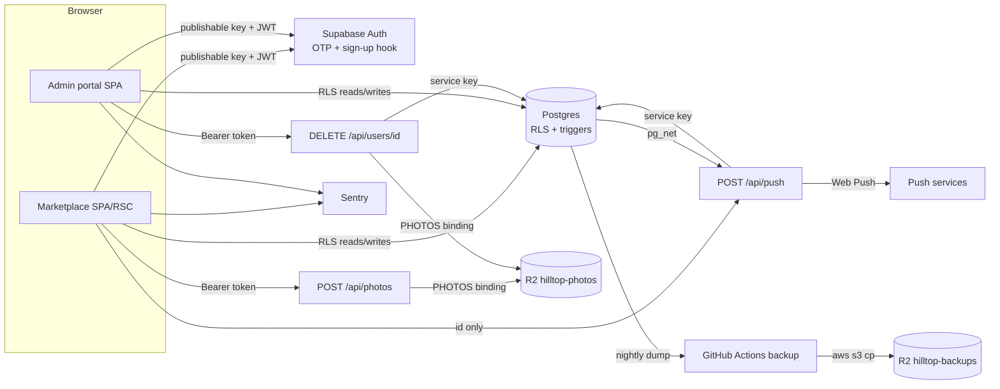

# Hilltop — Independent Codebase, Security & Production Readiness Audit

**Audit date:** 2 November 2026
**Repository audited:** `C:\Users\Emmanuel Adoum\Desktop\marketplace\web` (the Git repository root; the surrounding `marketplace\` folder also contains an empty `api\` directory and tooling folders)
**Auditor:** Principal Software Engineer / Application Security / Cloud Infrastructure / Database Security / QA review
**Application version audited:** commit `2340fb3` ("Turn on web push in production with the VAPID public key")

---

## 1. Executive Summary

Hilltop is a well-structured, unusually security-conscious student marketplace. The strongest part of the system is the database: every table is closed by default, access is granted column by column, row-level security is enabled everywhere, business rules (listing caps, banned words, offer minimums, order pricing, stock, status transitions) are enforced by triggers rather than by the client, and damaging administrative operations are guarded. The frontend is server-rendered for public pages and client-rendered for personal pages, so no per-user data is placed in a shared cache. Public pages are statically cached; personal pages are only shells.

That said, Hilltop is **not ready to operate with real students, and definitely not ready to take real payments**. The gaps are not in the authentication/RLS foundation — they are in the operational layer that the product promises:

1. **Admin dispute resolution, refunds and payout releases are not persisted.** `refundOrder`, `releaseOrder` and `resolveDispute` mutate only the browser's local state (`apps/admin/src/lib/model.ts`, `apps/admin/src/store.tsx`). The database has no `INSERT`/`UPDATE` grant on `disputes` or `dispute_messages`, and `saveOperations()` never writes orders or disputes. An admin can "refund" or "release" and see a success toast while nothing changes in the database.
2. **Students cannot open a dispute at all.** `openDispute` / `withdrawDispute` in the marketplace only change local state, and `public.disputes` is select-only. The header of the orders migration claims "disputes freeze payment", but there is no write path.
3. **The audit log is client-authored and incomplete.** Any admin — including a `viewer` with only `dashboard.view` — can insert arbitrary audit rows (confirmed against the live local database). Conversely, direct table writes (publishing config, editing roles, changing orders, deleting accounts through the API) are not automatically logged, so a malicious or careless admin can act without a record.
4. **Suspension does not stop selling.** Suspended sellers cannot create new listings, but they can renew, edit and keep live listings, and can still accept offers, which buyers can then order. Confirmed by reproduction.
5. **Backups are unverified and incomplete as a recovery strategy.** There is no restore test, no retention/lifecycle, no integrity verification and no failure alerting; the job silently skips when secrets are absent.
6. **The admin portal's Cloudflare Access protection cannot be verified from the repository** and is not represented in any configuration. If it is absent in production, the portal is publicly reachable (data still protected by RLS).

Additional material issues include an open-redirect bypass in the `next` sanitizer, multiple accepted offers on one listing, a buyer being able to complete an order unilaterally, an unauthenticated service-role push endpoint, no CSP, unbounded image uploads, and a marketplace data layer that ships up to 2,000 full listings to every visitor.

**Positives worth preserving:** the sign-up hook restricting institutional domains, the `guard_profile_update`/`guard_listing_write`/`guard_offer_update`/`move_order` trigger guards, the hard server-side refusal to create in-app-payment orders (`payments.inApp` cannot be enabled by config alone), the immutable audit table (no UPDATE/DELETE grants), the "at least one active owner" safeguard, the CSV formula-injection guard, magic-byte image validation, random non-reusable object keys, and the 129-assertion database security suite that currently passes.

**Recommended immediate actions (P0):** implement persisted dispute/refund/release workflows (or hide/disable them until they are real), make audit logging server-side and verifiable, close the suspension gap, verify Cloudflare Access in production, and perform and document a restore drill.

---

## 2. Audit Scope & Methodology

### 2.1 Repository components inspected

- `apps/web` — Next.js 16 App Router marketplace, Worker entry, API routes, client data layer, Vitest and Playwright tests.
- `apps/admin` — Next.js 16 admin portal, Worker entry, one server API route, model/operations/session layers, Vitest tests.
- `packages/shared` — platform config schema and defaults, permissions, catalog, payments, ranking, seed data, generated `database.types.ts`.
- `packages/ui` — design system, image loader, theme, hooks.
- `supabase/migrations` (19 migrations), `supabase/tests/security.test.sql`, `supabase/config.toml`, `bootstrap.sql`, `seed.sql`, `templates/code.html`.
- `.github/workflows/ci.yml`, `.github/workflows/backup.yml`.
- `apps/*/wrangler.jsonc`, `apps/*/open-next.config.ts`, `apps/*/next.config.ts`, `apps/*/worker.ts`, `package.json` files, `.gitignore`.
- Repository metadata (`git ls-files`, `git log`, ignore rules).

Environment files (`.env`, `.env.local`, `.env.production`) were **not** read, in line with the security constraint that their contents are secret-bearing. Only the variable **names** present in the committed `.env.production` files were enumerated with `grep -o '^NAME='`; no values were printed.

### 2.2 Commands executed and results

| Command | Result |
|---|---|
| `npm run format:check` | **PASS** — all files formatted |
| `npm run lint` | **PASS** — admin, web, shared, ui |
| `npm run typecheck` | **PASS** — route types generated, `tsc --noEmit` clean |
| `npm test` | **PASS** — 130 unit tests (admin 24, web 84, shared 22) |
| `npm run build` | **PASS** — 117 static pages generated; both apps build |
| `npm run db:test` | **PASS after reset** — 129/129 pgTAP assertions. First run showed 4 failures caused by a dirty local database (leftover rows), not by code; see §10. |
| `npx supabase db reset` | **PASS** — all 19 migrations + seed applied to a clean local database |
| `npx supabase db lint --local` | **PASS** — no schema errors |
| `npx supabase db advisors --local` | **PASS** — no advisor issues |
| `npm audit --omit=dev` | **5 moderate** advisories in build tooling (`glob`/`minimatch` via `@sentry/bundler-plugins`) |
| Targeted psql reproductions | Confirmed suspension bypass, multiple accepted offers, unilateral order completion, audit forgery by a `viewer`, and an open-redirect bypass via Node's WHATWG URL parser |

### 2.3 Tests not executed

- **Playwright e2e** (`npm run test:e2e`): not run. It requires a production build served on port 3100, Playwright's Chromium download, a clean local Supabase, and internet access for Unsplash imagery. The build and local Supabase were available; the browser install and the full suite were not run in this audit window. CI does run it.
- **Production verification**: Cloudflare Access, R2 bucket policies, production Supabase Auth settings (SMTP, rate limits, redirect allow-list), Sentry alert rules and the production database state are outside the repository and were not inspected. Findings that depend on them are marked **Needs verification**.
- **Penetration testing against production**: deliberately not performed.

### 2.4 Limitations and assumptions

- The stated architecture in the brief (root-level `apps/`, `packages/`, `supabase/`) does not match the repository layout: Hilltop is nested under `web/` inside the opened workspace, and `marketplace/api/` is empty. The audit targeted the actual Git repository at `web/`.
- Local reproduction used a disposable transaction (`BEGIN … ROLLBACK`) or a local database reset; no production data, credentials or external services were touched.
- CVSS 4.0 scores are provided only where the attack path was demonstrated; elsewhere a qualitative rating is used rather than inventing a vector.

---

## 3. Architecture Overview

### 3.1 Applications

| App | Runtime | Entry | Notes |
|---|---|---|---|
| `@hilltop/web` | Cloudflare Worker (OpenNext) | `apps/web/worker.ts` → `.open-next/worker.js`, wrapped by Sentry | `hilltop-web`, custom domain `hilltop.lumavok.com` |
| `@hilltop/admin` | Cloudflare Worker (OpenNext) | `apps/admin/worker.ts` | `hilltop-admin`, `admin.hilltop.lumavok.com`, `noindex` |

Both are Next.js 16.4.3 / React 19.3 apps using Tailwind v4, Framer Motion, react-hook-form and Zod. The marketplace uses a custom `next/image` loader (Unsplash resizing, otherwise pass-through), because Workers have no built-in image optimiser.

### 3.2 Data and identity

- **Supabase PostgreSQL** with 19 SQL migrations. Authentication is Supabase Auth, passwordless e-mail OTP (6 digits, 600 s) driven from the browser with the publishable key.
- **Row-level security is the authorization boundary.** There is no application middleware and no server session check on personal pages; the browser holds the Supabase session and every read/write is constrained by RLS. The admin portal likewise uses the publishable key from the browser, with `has_permission()` reading `admin_members`/`admin_roles`.
- **Two server routes use the service key**: `/api/push` (marketplace) and `DELETE /api/users/[id]` (admin). Both rely on Worker secrets (`SUPABASE_SECRET_KEY`, `VAPID_PRIVATE_KEY`).

### 3.3 Storage, e-mail, monitoring

- **R2**: `hilltop-photos` (public custom domain, uploads via `POST /api/photos`), `hilltop-web-opennext-cache` (Next incremental cache). Admin has the `PHOTOS` binding for account-deletion cleanup.
- **E-mail**: Supabase Auth's SMTP. A custom HTML OTP template exists (`supabase/templates/code.html`). **Resend is claimed in the privacy page and README but is not integrated anywhere in code.**
- **Sentry**: browser `instrumentation-client.ts` in both apps; Worker wrapper with `captureConsoleIntegration({ levels: ["error"] })` and `tracesSampleRate: 0.1`.
- **Push**: `pg_net` from a database trigger → `POST /api/push` → RFC 8291 encryption + RFC 8292 VAPID via WebCrypto.

### 3.4 Deployment and delivery

GitHub Actions: `checks` (format, lint, typecheck, unit, build) → `database` (migrations, pgTAP, lint, advisors) → `e2e` (build + Playwright against local Supabase) → `deploy` on `push` to `main`, gated on `CLOUDFLARE_API_TOKEN`. A separate nightly `backup` workflow dumps to R2.



### 3.5 Data flow for a reservation (verified)

1. Buyer submits `INSERT INTO orders (listing_id, quantity, slot, payment_kind='pickup')`.
2. `orders_active` rejects suspended buyers; `limit_rate` caps orders at 10/min; RLS requires `buyer_id = my_profile_id()`.
3. `prepare_order` (`SECURITY DEFINER`) locks the listing `FOR UPDATE`, rejects unavailable/own listings, clamps quantity to stock, **refuses any non-`pickup` payment kind**, applies an accepted offer price, copies title/pickup/seller, computes amount, then decrements stock (or marks a stockless listing sold).
4. `orders_placed` writes an `order_events` row and notifies the seller; `notifications_push` calls `/api/push`.
5. Buyer/seller move status via `move_order`; `order_moved` writes history, increments `profiles.sales` on collection, restores stock on cancellation, and notifies.

This path is genuinely server-enforced and is one of the strongest parts of the codebase.

---

## 4. Findings Summary

| ID | Severity | Category | Finding | Affected Component | Status |
|---|---|---|---|---|---|
| HILLTOP-SEC-001 | Medium | Security | Open redirect via backslash/tab in `next` sanitizer | `auth/callback`, sign-in/up | Confirmed |
| HILLTOP-SEC-002 | Medium | Security | Account enumeration through distinct OTP error messages | `lib/auth.ts` | Confirmed |
| HILLTOP-SEC-003 | Medium | Security | Session tokens are JS-readable; no server-side session boundary | Supabase browser client | Confirmed |
| HILLTOP-SEC-004 | Medium | Security/Correctness | Inviting an existing account as admin can never activate | `admin_members`, `team.ts` | Confirmed |
| HILLTOP-SEC-005 | Medium | Reliability | `email_sent = 2` per hour in Auth config | `supabase/config.toml` | Needs verification |
| HILLTOP-SEC-006 | Low | Security | Partial account deletion can leave a dangling auth user | admin delete route | Potential |
| HILLTOP-SEC-007 | Low | Security | OTP attempts limited per IP only, not per account | `config.toml` | Needs verification |
| HILLTOP-SEC-010 | High | Security | `team.manage` can grant itself every permission and the owner role | `admin_roles`, `admin_members` | Confirmed |
| HILLTOP-SEC-011 | High | Security | Audit log is forgeable and incomplete; actions can bypass logging | `audit_log`, admin client | Confirmed |
| HILLTOP-SEC-012 | High | Security | Suspended sellers can renew, edit and keep selling | `listings` update path | Confirmed |
| HILLTOP-SEC-013 | High | Infrastructure | Cloudflare Access for the admin portal is unverifiable/absent from config | `apps/admin`, wrangler | Needs verification |
| HILLTOP-SEC-020 | Medium | Security | Config publishing has no server-side schema validation | `config_releases` | Confirmed |
| HILLTOP-SEC-021 | Medium | Integrity | Multiple offers can be accepted on a single listing | `offers` | Confirmed |
| HILLTOP-SEC-022 | Medium | Integrity | Buyer can complete an order without the seller | `move_order` | Confirmed |
| HILLTOP-SEC-023 | High | Integrity | Admin refunds, releases and dispute resolutions are not persisted | admin model/store | Confirmed |
| HILLTOP-SEC-024 | High | Integrity | Students cannot open disputes; no write path exists | `disputes` | Confirmed |
| HILLTOP-SEC-025 | Low | Integrity | Anonymous users can inflate listing view counts | `listing_views` | Confirmed |
| HILLTOP-SEC-026 | Low | Privacy | Photos of draft/hidden listings readable by id | `listing_photos` policy | Confirmed |
| HILLTOP-SEC-027 | Low | Privacy | Message deletion can delete unrelated notifications by body match | `guard_message_update` | Confirmed |
| HILLTOP-SEC-028 | Low | Integrity | Listing/saved caps are race-prone | cap triggers | Potential |
| HILLTOP-SEC-029 | Informational | Architecture | `is_trusted_caller()` depends on `current_user` names | `rules.sql` | Informational |
| HILLTOP-SEC-030 | Medium | Security | `/api/push` is unauthenticated and uses the service key | `apps/web/src/app/api/push` | Confirmed |
| HILLTOP-SEC-031 | Medium | Security | SSRF via user-controlled push endpoint | `push_subscriptions` | Confirmed |
| HILLTOP-SEC-032 | Low | Privacy | Typing indicators use a public broadcast channel | `social.ts` | Confirmed |
| HILLTOP-SEC-033 | Medium | Security | No per-user upload quota; orphaned R2 objects | `/api/photos` | Confirmed |
| HILLTOP-SEC-034 | Low | Privacy | No server-side EXIF stripping or image decode validation | `photos-server.ts` | Confirmed |
| HILLTOP-SEC-035 | Low | Security | Public object-read fallback route | `/api/photos/[...key]` | Confirmed |
| HILLTOP-SEC-040 | Medium | Security | No CSP; thin security headers | both `next.config.ts` | Confirmed |
| HILLTOP-SEC-041 | High | Reliability | Backups are unrestored, unverified, unretained and silently skipped | `backup.yml` | Confirmed |
| HILLTOP-SEC-042 | Medium | Supply chain | CI lacks least privilege; actions unpinned; deploy token broad | `ci.yml` | Confirmed |
| HILLTOP-SEC-043 | Low | Reliability | In-memory revalidation queue loses work on isolate restart | `open-next.config.ts` | Confirmed |
| HILLTOP-SEC-044 | Informational | Security | Cloudflare account id and public env values committed | `wrangler.jsonc`, `.env.production` | Informational |
| HILLTOP-SEC-045 | Low | Supply chain | 5 moderate dependency advisories in build tooling | npm audit | Confirmed |
| HILLTOP-SEC-050 | Low | Privacy | Sentry has no PII scrubbing hook and captures all console errors | worker/Sentry init | Confirmed |
| HILLTOP-SEC-051 | Low | Architecture | Resend not implemented; production e-mail config absent from repo | e-mail layer | Confirmed |
| HILLTOP-PERF-001 | High | Performance | Whole market (up to 2,000 listings) fetched and shipped | `lib/market.ts` | Confirmed |
| HILLTOP-PERF-002 | Medium | Performance | Saved-search alerts fan out over every saved search per publish | `alert_saved_searches` | Confirmed |
| HILLTOP-PERF-003 | Medium | Performance | Admin portal over-fetches on every load | `operations.ts` | Confirmed |
| HILLTOP-PERF-004 | Medium | Performance | Conversation query loads every message in 100 threads | `social.ts` | Confirmed |
| HILLTOP-PERF-005 | Low | Performance | 20-second polling fallback reloads social + orders | `store.ts` | Confirmed |
| HILLTOP-PERF-006 | Medium | Performance | Full-size photos served for thumbnails | image loader | Confirmed |
| HILLTOP-REL-001 | Medium | Reliability | UI config and DB-enforced config diverge on Supabase outage | `config-server.ts` | Confirmed |
| HILLTOP-REL-002 | Medium | Correctness | Seller dashboard analytics are synthetic | `lib/analytics.ts` | Confirmed |
| HILLTOP-ARCH-001 | Informational | Architecture | Repository layout differs from documented structure | repo root | Informational |

### 4.1 Counts by severity

| Severity | Count |
|---|---|
| Critical | **0** |
| High | **8** |
| Medium | **19** |
| Low | **14** |
| Informational | **3** |
| **Total** | **44** |

---

## 5. Detailed Findings

### 5.1 Authentication & Session Security

#### [HILLTOP-SEC-001] Open redirect via backslash/tab bypass in the `next` sanitizer

**Severity:** Medium
**Category:** Security
**Status:** Confirmed

**Affected components:**
- `apps/web/src/app/auth/callback/route.ts` (OAuth callback)
- `apps/web/src/app/sign-in/sign-in-flow.tsx` (`safeNext`, used by sign-in and sign-up)

**Evidence:**
- `apps/web/src/app/auth/callback/route.ts:9-10` — `const next = ...; const safeNext = next.startsWith("/") && !next.startsWith("//") ? next : "/";`
- `apps/web/src/app/auth/callback/route.ts:21` — `NextResponse.redirect(new URL(safeNext, url.origin))`
- `apps/web/src/app/sign-in/sign-in-flow.tsx:15-16` — identical `safeNext` predicate; `:25` uses the result as the post-login destination.
- `apps/web/src/lib/auth.ts:84` — the OAuth redirect nests `next` into `redirectTo`.

**Description:**
The sanitizer only rejects values beginning with `//`. The WHATWG URL parser treats backslashes (and tabs) as path separators for special schemes, so a value such as `/\evil.com` starts with `/`, is accepted, then resolves to `https://evil.com/`. Verified with Node:

```
"/\\evil.com"  -> accepted -> https://evil.com/
"/\t/evil.com" -> accepted -> https://evil.com/
```

**Impact:**
After a school (OAuth) sign-in, a crafted link can bounce the victim to an attacker-controlled site that mimics Hilltop and phishes for re-authentication. Requires the OAuth/SSO provider to be enabled and the victim to complete a real sign-in; it does not yield account takeover by itself. Current posture is partly mitigating because `NEXT_PUBLIC_SSO_PROVIDER` is unset, so the OAuth path is inert.

**Reproduction:**
1. Enable an SSO provider (`NEXT_PUBLIC_SSO_PROVIDER`), or test `safeNext` directly.
2. After initiating sign-in, visit `/auth/callback?code=<valid>&next=%2F%5Cevil.com`.
3. Observe the `Location` header pointing at `https://evil.com/`.

**Recommended remediation:**
Parse with `new URL(next, origin)` and require `parsed.origin === origin`; redirect using `parsed.pathname + parsed.search + parsed.hash`. Apply the same helper on both client and server.

**Validation:**
Unit-test `safeNext` with `//evil.com`, `/\evil.com`, `/\t/evil.com`, `https://evil.com`, `%2f%2fevil.com`, `/me?tab=selling`; every result must stay on the origin.

**References:** OWASP Unvalidated Redirects and Forwards; WHATWG URL Standard (backslash as special-scheme separator).

---

#### [HILLTOP-SEC-002] Account enumeration through distinct OTP error messages

**Severity:** Medium
**Category:** Security
**Status:** Confirmed

**Affected components:**
- `apps/web/src/lib/auth.ts` (`authMessage`)
- `apps/web/src/app/sign-in/sign-in-flow.tsx`

**Evidence:**
- `apps/web/src/lib/auth.ts:17` — `authMessage(...)`
- `apps/web/src/lib/auth.ts:22` — `if (code === "otp_disabled" || /signups not allowed/i.test(text)) return "There's no account with this email yet. Create one instead.";`
- Sign-in uses `shouldCreateUser: false`; sign-up uses `shouldCreateUser: true`.

**Description:**
For sign-in, Supabase returns a distinct error when no account exists, and the UI surfaces "There's no account with this email yet." That is a reliable oracle distinguishing registered from unregistered addresses. Sign-up responses can additionally distinguish allowed-domain refusal (403).

**Impact:**
An attacker can enumerate which `@ashesi.edu.gh` addresses have Hilltop accounts, enabling targeted phishing and correlation with other campus systems. Rate limits reduce but do not eliminate the value over time. Requires only unauthenticated access to the public Auth endpoint.

**Reproduction:**
Call `supabase.auth.signInWithOtp({ email, options: { shouldCreateUser: false } })` for a known and an unknown address; compare `code`/`message` and the rendered copy.

**Recommended remediation:**
Always show a neutral message ("If that address has an account, we've sent a code") and do not branch UI copy on `otp_disabled`/`signups not allowed`. Keep the server-side sign-up hook as the real gate.

**Validation:**
Automated test asserting identical copy and response shape for existing and non-existing addresses.

**References:** OWASP Authentication Cheat Sheet — account enumeration.

---

#### [HILLTOP-SEC-003] Session tokens are JavaScript-readable; no server-side session boundary

**Severity:** Medium
**Category:** Security
**Status:** Confirmed

**Affected components:**
- `apps/web/src/lib/supabase.ts`, `apps/admin/src/lib/supabase.ts`
- All personal pages (`/me`, `/inbox`, `/notifications`, `/saved`, admin portal)

**Evidence:**
- Both apps use `createBrowserClient` from `@supabase/ssr` (`apps/web/src/lib/supabase.ts:20`, `apps/admin/src/lib/supabase.ts:20`).
- No application `middleware.ts` exists in either app (`find apps -name middleware.ts` returns only generated OpenNext internals).
- Personal pages are statically prerendered shells whose data loads in the browser (`apps/web/src/app/me/page.tsx`, `/inbox`, `/notifications`, `/saved`, `/dashboard`).

**Description:**
The session is created, stored and refreshed entirely in the browser. Because the client must call Supabase directly, tokens cannot be `HttpOnly`; any XSS, page-capable extension or compromised dependency can read and exfiltrate them. There is also no server-side gate: opening `/me` or the admin portal without a session renders the shell, then redirects client-side. Actual data remains protected by RLS, so this is defense-in-depth and detection, not an authorization bypass.

**Impact:**
A successful script injection yields full impersonation for the token lifetime (1-hour access token, rotating refresh token). Admin impersonation follows the same path. The absence of a CSP (HILLTOP-SEC-040) increases exploitability.

**Reproduction:**
After sign-in on `hilltop.lumavok.com`, inspect `document.cookie`; the `sb-*-auth-token` value is present and readable.

**Recommended remediation:**
If server-rendered personal routes are introduced, use `@supabase/ssr` server helpers with `HttpOnly`, `Secure`, `SameSite=Lax` cookies and middleware that rejects unauthenticated requests before rendering. Regardless, add a strict CSP with nonces and a restricted `connect-src`.

**Validation:**
`HttpOnly`/`Secure` visible in `Set-Cookie`; unauthenticated request to a protected route returns 302/401 before HTML.

**References:** OWASP Session Management Cheat Sheet; Supabase SSR guidance.

---

#### [HILLTOP-SEC-004] Inviting an existing account as an admin can never activate

**Severity:** Medium
**Category:** Security / Correctness
**Status:** Confirmed

**Affected components:**
- `public.admin_members` grants/policies
- `apps/admin/src/lib/team.ts` (`invite`)
- `public.handle_new_user()`

**Evidence:**
- `apps/admin/src/lib/team.ts:88` — invite inserts `{ name, email, role_id }` only.
- `supabase/migrations/20261101120400_security.sql` grants `insert (email, name, role_id)` and `update (name, role_id)` on `admin_members`; there is no grant to set `status` or `profile_id`.
- `supabase/migrations/20261102120000_session_profile.sql` activates an invite only inside `handle_new_user()` (on `INSERT INTO auth.users`).

**Description:**
Activation is a trigger on auth-user creation. If the invitee already has a Hilltop account (the normal case when promoting a student or existing staff), no new auth user is created, the trigger never fires, and the row stays `status='invited', profile_id=NULL` forever. Neither the portal nor the API can set `status`/`profile_id`.

**Impact:**
Promoting an existing user silently fails. The owner believes access was granted; the invitee is told they are "not on the team". This encourages workarounds (e.g., inviting a personal address), weakening the admin access model.

**Reproduction:**
1. Sign in as an existing student (creates a profile).
2. As an owner, invite that same e-mail.
3. Sign in to the admin portal: the row stays `invited` and the portal reports "not on the admin team" permanently.

**Recommended remediation:**
On invite, if a profile already exists, link and activate it server-side (a `SECURITY DEFINER` RPC that checks `team.manage`, or a trigger on `admin_members`). Do not expose `status`/`profile_id` as direct client grants.

**Validation:**
Database test: invite an existing profile, assert `status='active'`, `profile_id` set, and `has_permission()` returns the role's permissions.

---

#### [HILLTOP-SEC-005] `email_sent = 2` per hour in the Auth configuration

**Severity:** Medium
**Category:** Reliability
**Status:** Needs verification

**Affected components:**
- `supabase/config.toml:200`

**Evidence:**
- `supabase/config.toml:200` — `email_sent = 2` ("Number of emails that can be sent per hour").
- `:208` `sign_in_sign_ups = 30`, `:210` `token_verifications = 30`, `:235` `otp_expiry = 600`.

**Description:**
If production Auth mirrors this limit, the project can send only **two** OTP e-mails per hour before rate limiting. A pilot of a handful of students would hit it immediately, and the UI tells users to "wait a minute" although the window is an hour. Local config does not prove production config, hence "Needs verification".

**Impact:**
Sign-in and sign-up become unavailable under trivial load; the admin portal is locked out at the same time. Recovery requires a Supabase dashboard change.

**Reproduction:**
Request three codes within an hour against an environment using this configuration; the third returns a rate-limit error.

**Recommended remediation:**
Set a realistic per-hour e-mail budget (Supabase default 30; scale with expected logins), keep per-address `max_frequency` at ~60 s, and monitor delivery failures.

**Validation:**
Load test of N concurrent sign-ins; all receive codes within budget, and the limit is documented as a capacity threshold.

**References:** Supabase Auth rate limits documentation.

---

#### [HILLTOP-SEC-006] Partial account deletion can leave a dangling auth user

**Severity:** Low
**Category:** Security
**Status:** Potential

**Affected components:**
- `apps/admin/src/app/api/users/[id]/route.ts`

**Evidence:**
- The route deletes photos, chat notifications and the `profiles` row, then calls `server.auth.admin.deleteUser(profile.user_id)`.
- On Auth failure it returns `500` ("Their data is gone, but the sign-in couldn't be deleted") after the profile is irreversibly deleted.

**Description:**
If `deleteUser` fails (Auth outage, missing service key, token error), the `auth.users` row survives while the profile is gone. The person can still sign in; `handle_new_user` will not fire again, and `app_metadata.profile_id` references a deleted profile. They get a session with no profile and no access, and the address cannot be reused cleanly.

**Impact:** Confusing, hard-to-recover account state; support burden. No privilege gain.

**Reproduction:** Delete a user with an invalid `SUPABASE_SECRET_KEY`: profile deletion succeeds, Auth deletion errors.

**Recommended remediation:**
Delete the auth user first, or use a compensating workflow with retry/queue; record a durable "pending deletion" marker and surface it to admins. Add an idempotent reconciliation job.

**Validation:** Fault-injection test on each step; a re-run completes remaining work.

---

#### [HILLTOP-SEC-007] OTP verification is limited per IP, not per account

**Severity:** Low
**Category:** Security
**Status:** Needs verification

**Affected components:**
- `supabase/config.toml:210`

**Evidence:**
- `token_verifications = 30` per five minutes per IP; `sign_in_sign_ups = 30` per five minutes per IP.
- `otp_length = 6`, `otp_expiry = 600`.

**Description:**
Thirty guesses per five-minute window against a 6-digit code gives a per-window success probability of roughly 3×10⁻⁵, and codes are invalidated on success. That is acceptable, but there is no per-account attempt cap, so a distributed attacker can spread guesses across IPs.

**Impact:** Low probability of OTP guessing; practical risk is nuisance/DoS (burning codes and e-mail quota).

**Reproduction:** Locally, repeated `verifyOtp` calls return invalid-token errors without a per-account lockout.

**Recommended remediation:**
Add a per-address attempt counter with exponential backoff and a short lockout after ~5 failures; enable Turnstile/CAPTCHA on Auth if abuse appears.

**Validation:** Six wrong codes for one address produce a lockout; a correct code is refused until the window passes.

---

### 5.2 Authorization & Access Control

#### [HILLTOP-SEC-010] `team.manage` can grant itself every permission and the owner role

**Severity:** High
**Category:** Security
**Status:** Confirmed

**Affected components:**
- `public.admin_roles`, `public.admin_members` grants/policies
- `public.has_permission()`
- `apps/admin/src/lib/team.ts`

**Evidence:**
- `supabase/migrations/20261101120400_security.sql` grants `insert/update (permissions)` on `admin_roles` and `insert/update (role_id)` on `admin_members` to `authenticated`, with policies requiring only `team.manage`.
- `supabase/migrations/20261101120200_platform.sql` — `has_permission()` returns true for `r.id = 'owner'` or `permission = any (r.permissions)`.
- `supabase/migrations/20261101120300_rules.sql:279` — `keep_an_owner()` only requires that *some* active owner exists.

**Description:**
`team.manage` is documented as "invite admins and edit roles and permissions". A holder can edit their own role's `permissions` to include `settings.publish`, `users.delete`, `orders.refund`, etc., and can set their own `admin_members.role_id` to `'owner'`. `team.manage` is therefore transitively equivalent to full owner control. No rule restricts creating/assigning the owner role or self-escalation.

**Impact:**
Any admin with `team.manage` (e.g., an Operations lead) can take over: grant all permissions, become owner, remove the legitimate owner (once a second owner exists), then change config, delete users and read all data. This is inside the trust boundary but violates least privilege and defeats the "at least one owner" safeguard against a rogue insider.

**Reproduction (safe, local):** As a member whose role has `team.manage` but not `users.delete`:
```sql
update public.admin_roles set permissions = array['users.delete','settings.publish'] where id = '<my-role>';
update public.admin_members set role_id = 'owner' where profile_id = private.my_profile_id();
```
Both succeed.

**Recommended remediation:**
- Restrict owner-role assignment and owner permissions to existing owners (a `SECURITY DEFINER` function with an explicit check) and forbid self-role changes.
- Split `team.manage` into `team.invite`, `team.roles`, `team.owner`, or make it owner-only.
- Require submitted permissions to be a subset of the caller's effective permissions.

**Validation:**
Database tests: a non-owner with `team.manage` cannot assign `owner`, cannot add a permission it lacks, and cannot change its own role.

---

#### [HILLTOP-SEC-011] Audit log is forgeable and incomplete; admin actions can bypass logging

**Severity:** High
**Category:** Security
**Status:** Confirmed

**Affected components:**
- `public.audit_log` grants/policies
- `apps/admin/src/lib/store.tsx` (`syncToDatabase`), `audit.ts`, `team.ts`
- `apps/admin/src/app/api/users/[id]/route.ts`

**Evidence:**
- `supabase/migrations/20261101120400_security.sql:310` — `grant select, insert (permission, action, target, actor_name) on public.audit_log to authenticated;`
- `:313` — policy `"Admins record their actions"` requires only `public.is_admin()`. Every admin, including a `viewer`, satisfies it.
- `apps/admin/src/lib/store.tsx:142-168` — audit rows are inserted **by the browser** after each local state change.
- `apps/admin/src/lib/team.ts` — `recordAudit()` is a fire-and-forget client insert.
- The account-deletion API route performs a destructive operation with no server-side audit write.

**Description:**
The audit log is not a security control; it is a client courtesy. Verified against the local database: an admin whose `my_permissions()` is `{dashboard.view}` successfully inserted a row claiming `permission='orders.refund', action='Refunded order (forged)'`. The server overwrites only `actor_id`, `actor_name` and `at`; `permission`, `action` and `target` are caller-chosen. Actions performed directly against the API (publishing config, updating roles, modifying profiles/listings, deleting an account) are not logged automatically.

**Impact:**
Fraudulent entries can be planted, real actions can be omitted, and the record is not trustworthy for disputes, insider investigations or compliance. Because refunds/disputes are not persisted (HILLTOP-SEC-023), the log can describe events that never happened.

**Reproduction:**
```sql
set local role authenticated;
select set_config('request.jwt.claims','{"sub":"<viewer-uuid>","role":"authenticated"}',true);
insert into public.audit_log (permission,action,target,actor_name)
values ('orders.refund','Refunded order (forged)','ord-9999','-');
```
Returns `INSERT 0 1`.

**Recommended remediation:**
- Write audit entries in the database via triggers on sensitive tables (`config_releases`, `admin_members`, `admin_roles`, profile status/verified, listing moderation, report handling), deriving `permission` from the operation.
- Revoke direct `INSERT` on `audit_log` from `authenticated`; expose only a validated `SECURITY DEFINER` RPC if needed.
- Add a hash chain or periodic signed digest for tamper evidence.
- Log the account-deletion API action server-side with its target.

**Validation:**
The insert above must fail for a viewer and a student. Each admin action produces exactly one trigger-generated row with the correct permission and actor.

---

#### [HILLTOP-SEC-012] Suspended sellers can renew, edit and keep selling

**Severity:** High
**Category:** Security / Integrity
**Status:** Confirmed

**Affected components:**
- `public.listings` update policy and `guard_listing_write()`
- `public.check_listing_rules()`
- `require_active_student()` triggers
- `guard_offer_update()`

**Evidence:**
- `supabase/migrations/20261101120400_security.sql:92` — `"Sellers edit their listings; moderators change status"` requires only `seller_id = my_profile_id()`.
- `supabase/migrations/20261102160000_hardening.sql:24-35` — `require_active_student()` is attached to **inserts only**.
- `supabase/migrations/20261101120300_rules.sql:83` / `20261101140000_private_helpers.sql:61` — `guard_listing_write()` never checks profile status.
- `supabase/migrations/20261102110000_selling.sql:13-66` — `check_listing_rules()` never checks profile status.

**Description:**
Suspension blocks new listings (insert policy requires `profiles.status='active'`) and new messages/offers/orders/reviews/reports. It does not block `UPDATE` on existing listings. A suspended seller can bump `posted_at` (renew), change price/title, and still accept pending offers; a buyer can then order and complete. **Confirmed by reproduction** on the local database: after suspension, `UPDATE listings SET posted_at = now()` and `UPDATE listings SET title/price` each returned `UPDATE 1`, while a new listing insert correctly failed with an RLS error.

**Impact:**
The primary moderation control is ineffective. A suspended account can keep transacting and keep listings ranked as fresh, undermining trust and safety. Buyers may transact with a seller the team intended to remove.

**Reproduction:**
1. Create a listing as an active student.
2. As `postgres`, `UPDATE profiles SET status='suspended'`.
3. As the student, `UPDATE listings SET posted_at=now(), title='Still selling' WHERE id=...` → succeeds.
4. `INSERT INTO listings ...` → fails.

**Recommended remediation:**
Add a `require_active_student()` `BEFORE UPDATE` trigger on `listings` and a status check in `guard_offer_update()`, or extend `guard_listing_write()` to reject writes by suspended profiles unless the caller is a moderator. Also hide/sold-out the seller's live listings when suspension is applied (the admin UI does this only locally).

**Validation:**
Extend `supabase/tests/security.test.sql`: a suspended seller's `UPDATE` on title, price, status and `posted_at` must raise `23514`; accepting/declining an offer must also fail.

---

#### [HILLTOP-SEC-013] Cloudflare Access for the admin portal is unverifiable and absent from configuration

**Severity:** High
**Category:** Infrastructure
**Status:** Needs verification

**Affected components:**
- `apps/admin/wrangler.jsonc`, `apps/admin/next.config.ts`
- Deployment documentation

**Evidence:**
- `apps/admin/wrangler.jsonc` defines a custom domain only: `{ "pattern": "admin.hilltop.lumavok.com", "custom_domain": true }`. No Access application, policy or service token exists in the repository.
- `README.md:85` states "On production the portal also sits behind Cloudflare Access."
- No `middleware.ts` exists; the portal shell is served to anyone, and only data access is gated by RLS.

**Description:**
Cloudflare Access is an account-level control that cannot be verified from source. If it is not configured (or allows a broad e-mail domain), the admin sign-in page and portal shell are publicly reachable. That is not an authorization bypass — every query still passes through RLS and requires an active `admin_members` row — but it removes an important layer, exposing Auth abuse and client-side attack surface.

**Impact:** Conditional. With Access absent or lax, the only barrier is Supabase Auth + RLS. A compromise of an admin's e-mail/OTP yields full admin capability.

**Reproduction:** `curl -I https://admin.hilltop.lumavok.com/` from a non-approved network; a `200` with the sign-in page indicates no Access gate. (Not performed — external production testing was out of scope.)

**Recommended remediation:**
- Codify Access in Terraform (or document the exact dashboard policy) with an explicit team allow-list, enforcing Access on `admin.hilltop.lumavok.com/*`.
- Add WAF rate limits on `/auth/v1/otp` and the admin origin.
- Verify the policy after every deployment and record it in the runbook.

**Validation:** Unauthenticated request from a non-approved network returns a Cloudflare Access login/403; an approved identity reaches the portal.

---
### 5.3 Database & Data Integrity

#### [HILLTOP-SEC-020] Config publishing has no server-side schema validation

**Severity:** Medium
**Category:** Security / Integrity
**Status:** Confirmed

**Affected components:**
- `public.config_releases`, `public.config_draft`
- `apps/web/src/lib/config-server.ts`, `packages/shared/src/config.ts`

**Evidence:**
- `supabase/migrations/20261101120200_platform.sql` — `config jsonb not null check (jsonb_typeof(config) = 'object')` is the only constraint.
- `supabase/migrations/20261101120400_security.sql` — publish policy requires only `settings.publish`.
- `apps/web/src/lib/config-server.ts:18-35` — invalid config falls back to `defaultConfig` and logs a warning.
- Zod validation lives in `packages/shared/src/config.ts` and runs in the admin client, not in the database.

**Description:**
An admin can `POST` an arbitrary JSON object to `config_releases` and publish it. The marketplace detects schema issues and silently runs on defaults, while database rules (`check_listing_rules`, `check_offer`, `prepare_order`, `hook_before_user_created`) read the *published* config directly. Invalid or extreme-but-valid values therefore create two realities: the UI enforces defaults, the database enforces the published config.

**Impact:**
A single malformed publish can change fees, categories, listing caps and allowed e-mail domains unexpectedly, degrade the marketplace to defaults, or make listing/ordering impossible. Availability/consistency issue, not an authorization bypass.

**Reproduction:** As an owner, `INSERT INTO config_releases (config) VALUES ('{"version":1}')`; the marketplace falls back to defaults while the database uses the partial config.

**Recommended remediation:**
Validate config in a `BEFORE INSERT` trigger (or a `SECURITY DEFINER` publish function) using the same schema; reject unknown keys, out-of-range values and missing sections. Store a schema version and refuse incompatible releases.

**Validation:** Publishing `{}` and `{"listings":{"maxActive":-1}}` must raise; a valid config publishes and is read identically by app and database.

---

#### [HILLTOP-SEC-021] Multiple offers can be accepted on a single listing

**Severity:** Medium
**Category:** Integrity / Business logic
**Status:** Confirmed

**Affected components:**
- `public.offers`, `guard_offer_update()`, `check_offer()`, `prepare_order()`

**Evidence:**
- `supabase/migrations/20261101120100_commerce.sql` — only a partial unique index for **pending** offers: `offers_one_pending_idx ... where status = 'pending'`.
- `supabase/migrations/20261101140000_private_helpers.sql` — `guard_offer_update()` permits any `pending → accepted` by the seller, with no check for another accepted offer.
- `supabase/migrations/20261102130000_conversations.sql:94` — `check_offer()` withdraws only the **same buyer's** pending offers.
- `supabase/migrations/20261102140000_orders.sql:23` — `prepare_order()` selects the newest accepted offer for that buyer and applies its price.

**Description:**
The seller can accept every pending offer on a listing (confirmed: `UPDATE 2`, leaving two `accepted` rows). Each buyer can then order at their own accepted price, and stock is decremented independently. Nothing revokes the others when one is accepted or an order is placed.

**Impact:**
Inconsistent pricing and commitments: several buyers believe a price was agreed, the listing can be oversold or sold below the intended price, and (once in-app payments exist) multiple buyers could be charged for one item. Today, with pay-at-pickup, impact is broken expectations and seller confusion.

**Reproduction:**
1. Buyer A offers 140, buyer B offers 150 on the same listing.
2. Seller accepts both (`UPDATE ... WHERE status='pending'` affects 2 rows).
3. Each buyer inserts a `pickup` order; both are priced from their own accepted offer.

**Recommended remediation:**
Add a unique index enforcing at most one `accepted` offer per listing; on acceptance, withdraw/decline all other pending offers in the same statement. Consider reserving stock on acceptance.

**Validation:** Database test: accepting a second offer raises a violation or automatically withdraws the first; only one accepted offer exists per listing.

---

#### [HILLTOP-SEC-022] Buyer can complete an order without the seller

**Severity:** Medium
**Category:** Integrity / Business logic
**Status:** Confirmed

**Affected components:**
- `public.move_order()` (`supabase/migrations/20261102140000_orders.sql:121-149`)

**Evidence:**
- `:139` — `or (new.status = 'collected' and old.status in ('paid', 'ready') and old.payment_kind = 'pickup')` — no `v_seller` condition, unlike the `ready` transition.
- `:172` — on `collected`, `order_moved()` increments `profiles.sales` and sends a review prompt.

**Description:**
For pay-at-pickup orders, either party may mark `collected`. That is defensible when "collected" means "buyer confirms receipt", but it also lets a buyer mark an order collected before meeting or paying, and lets a seller mark it collected without buyer confirmation. Confirmed: a buyer's `UPDATE ... SET status='collected'` succeeded.

**Impact:**
Premature completion inflates seller sales, unlocks reviews for a transaction that may not have happened, and (critically) is the transition that would release held money once in-app payments are enabled. Semantics must be explicit before money is involved.

**Reproduction:** As the buyer of a `pickup` order in `paid`, `UPDATE orders SET status='collected'`; it succeeds and `order_events` records the buyer.

**Recommended remediation:**
Split the transition: seller marks `handed_over`, buyer confirms `collected`; or require the actor to match the intended role per transition. Record the actor and add a "buyer confirmed" flag. Do this before enabling held payments.

**Validation:** A buyer cannot mark `handed_over`; a seller cannot mark `collected` without buyer confirmation. Tests assert each actor's allowed transitions.

---

#### [HILLTOP-SEC-023] Admin refunds, payout releases and dispute resolutions are not persisted

**Severity:** High
**Category:** Integrity / Correctness
**Status:** Confirmed

**Affected components:**
- `apps/admin/src/lib/model.ts` (`refundOrder`, `releaseOrder`, `resolveDispute`)
- `apps/admin/src/lib/store.tsx` (`syncToDatabase`)
- `apps/admin/src/lib/operations.ts` (`saveOperations`)
- Admin order/dispute views

**Evidence:**
- `apps/admin/src/lib/model.ts:102` `refundOrder`, `:112` `releaseOrder`, `:122` `resolveDispute` — pure functions returning a new local `AdminState`.
- `apps/admin/src/lib/store.tsx:142-168` — `syncToDatabase` calls `saveOperations` only when `before.users !== after.users || before.listings !== after.listings`; it then writes the draft and one audit row. Orders and disputes are never written.
- `apps/admin/src/lib/operations.ts:157` — `saveOperations` handles users, listings and reports only; there is no `from("orders")` / `from("disputes")` update anywhere in `apps/admin/src` (grep confirms only reads).
- `supabase/migrations/20261101120400_security.sql:198` grants only `SELECT` on `orders`, `disputes` and `dispute_messages`.

**Description:**
The portal shows "Buyer refunded" / "Payout released" and updates the table, but the change exists only in React state (and briefly in `localStorage`). Reloading discards it. There is no RPC and no service-role route for these operations. This is the most serious product-integrity gap: the admin interface claims to settle money and disputes.

**Impact:**
An operator can believe a refund or payout happened when it did not. Once Paystack is enabled, this becomes a direct financial-discrepancy and potential fraud vector. Today it corrupts operational trust and the audit trail (HILLTOP-SEC-011).

**Reproduction:**
1. Open an order/dispute in the admin portal, choose refund/release/resolve.
2. Observe the success toast and the row changing.
3. Reload, or query the database: status unchanged, no `order_events` row.

**Recommended remediation:**
Either (a) implement real server-side commands — `SECURITY DEFINER` functions (`refund_order`, `release_order`, `resolve_dispute`) that check permission, enforce transitions, and write orders/events/disputes plus an audit row atomically; or (b) disable/hide these controls and label them "coming with in-app payments". Never show success for an unpersisted change.

**Validation:** After each action, assert the database row, event history and audit entry changed; a reload must not be needed.

---

#### [HILLTOP-SEC-024] Students cannot open or withdraw disputes; no write path exists

**Severity:** High
**Category:** Integrity / Correctness
**Status:** Confirmed

**Affected components:**
- `public.disputes`, `public.dispute_messages`
- `apps/web/src/lib/store.ts` (`openDispute`, `withdrawDispute`)
- `apps/web/src/lib/model.ts`

**Evidence:**
- `apps/web/src/lib/store.ts` — `openDispute` and `withdrawDispute` call only `commit(...)`; there is no Supabase call.
- `supabase/migrations/20261101120400_security.sql:198` — `grant select on public.orders, public.order_events, public.disputes, public.dispute_messages to authenticated;` — no insert/update grant or policy exists.
- `README.md` and the orders migration header claim disputes freeze payment.

**Description:**
Disputes are entirely local UI state in the marketplace. A buyer can "open a dispute", see it in their order card, and it disappears on reload. Nothing is stored, and no admin can see it (the portal loads disputes from the database). The feature is presented as live but is not implemented.

**Impact:**
Buyers with a problem have no real recourse and may believe they filed a dispute. Combined with HILLTOP-SEC-023, the entire dispute/release workflow is cosmetic. This directly contradicts the product's core payment-protection promise.

**Reproduction:** Open a dispute on an order, reload `/me`; the dispute is gone and `SELECT count(*) FROM disputes` is unchanged.

**Recommended remediation:**
Implement `open_dispute` / `withdraw_dispute` as validated server functions (participant, order status, time window, one open dispute per order), insert `dispute_messages`, add an `order_events` entry and notify the other party/admins. If not ready, remove the controls and the claim.

**Validation:** End-to-end: buyer opens a dispute, admin and seller see it, status freezes, database rows exist.

---

#### [HILLTOP-SEC-025] Anonymous users can inflate listing view counts

**Severity:** Low
**Category:** Integrity
**Status:** Confirmed

**Affected components:**
- `public.listing_views`, `count_listing_view()`
- Ranking (`packages/shared/src/ranking.ts`)

**Evidence:**
- `supabase/migrations/20261102100000_public_profiles.sql` — `grant insert (listing_id) on public.listing_views to anon, authenticated;`
- `20261102110000_selling.sql` — the trigger increments `listings.views` for active listings and discards the row; no per-user/IP deduplication.
- `packages/shared/src/ranking.ts` uses popularity (views/saves) in "Best match".

**Description:**
Any visitor can loop `INSERT INTO listing_views` and inflate views without limit. The client deduplicates once per tab, but the API does not.

**Impact:** Ranking manipulation and misleading social proof; a seller can promote their own listing for free. Also skews an already partly synthetic seller dashboard (HILLTOP-REL-002).

**Reproduction:** Repeatedly `INSERT INTO listing_views (listing_id) VALUES ('<live>')` as `anon`; the counter increases each time.

**Recommended remediation:**
Add a coarse per-IP/JWT rate limit, cap increments per listing per window, and weight recent views rather than raw totals. Do not use raw views as a ranking input without normalization.

**Validation:** A burst yields a bounded increment; a normal page view increments once.

---

#### [HILLTOP-SEC-026] Photos of draft and hidden listings are readable by id

**Severity:** Low
**Category:** Privacy
**Status:** Confirmed

**Affected components:**
- `public.listing_photos` select policy

**Evidence:**
- `supabase/migrations/20261101120400_security.sql:103` — `create policy "Photos are visible with their listing" ... using (exists (select 1 from public.listings l where l.id = listing_id));`
- The policy does not require the listing to be `active`/`sold` or owned by the caller.

**Description:**
The EXISTS subquery runs with the caller's RLS, so a draft/hidden listing is not visible to strangers — but the photo row is only checked for the listing's existence, not its status. The practical leak is limited to users who can already see the listing (owner/moderator), yet the policy states the wrong rule and is fragile if the listings policy is broadened.

**Impact:** Minimal today; could expose unpublished media if listings visibility changes.

**Reproduction:** As the owner of a draft, `select * from listing_photos where listing_id='<draft>'` succeeds; as another student it fails.

**Recommended remediation:** Mirror the listings visibility predicate inside the photo policy.

**Validation:** A stranger cannot read photos of a draft/hidden listing.

---

#### [HILLTOP-SEC-027] Message deletion can delete unrelated notifications by body match

**Severity:** Low
**Category:** Privacy
**Status:** Confirmed

**Affected components:**
- `guard_message_update()` in `20261102190000_records_and_messaging.sql`

**Evidence:**
- Delete branch: `delete from public.notifications where href = '/inbox?c=' || old.conversation_id and body = left(old.body, 500);`

**Description:**
Notifications are matched by conversation link plus the first 500 characters. If two messages in the same conversation start identically (common: "Is it still available?"), deleting one removes the other's notification too.

**Impact:** Lost notifications (a recipient may miss a message). Minor integrity issue, not a leak.

**Reproduction:** Send the same text twice, delete the first; both notifications disappear.

**Recommended remediation:** Store a `message_id` on the notification and delete by id.

**Validation:** Deleting one of two identical messages leaves the other notification intact.

---

#### [HILLTOP-SEC-028] Listing and saved-item caps are race-prone

**Severity:** Low
**Category:** Integrity
**Status:** Potential

**Affected components:**
- `check_listing_rules()` (`20261102110000_selling.sql:49`)
- `check_saved_cap()` (`20261102180000_full_deletion_and_caps.sql`)

**Evidence:**
- Both do `select count(*)` and compare to the cap without locking the profile or using a serializable transaction.

**Description:** Two concurrent requests can both observe `count = cap - 1` and both insert, exceeding the cap by one. The window is small and the client serializes most interactions.

**Impact:** Minor over-listing or over-saving; no security boundary crossed.

**Recommended remediation:** Use a per-profile advisory lock or a counter row with `UPDATE ... RETURNING`, or a deferred constraint trigger.

**Validation:** A concurrent-insert test never exceeds the cap.

---

#### [HILLTOP-SEC-029] `is_trusted_caller()` depends on `current_user` names

**Severity:** Informational
**Category:** Architecture
**Status:** Informational

**Affected components:**
- `public.is_trusted_caller()` (`20261101120300_rules.sql`, moved to `private`)

**Evidence:**
- `select current_user in ('postgres', 'supabase_admin', 'service_role');`

**Description:**
Trust is inferred from the role name. This works for the current Supabase topology and is used correctly (guards return early only for trusted callers), but it is brittle: a future role rename, `SET ROLE`, or a `SECURITY DEFINER` function owned by `postgres` changes the answer. Several definer triggers rely on it and therefore also check `my_profile_id() is null`.

**Impact:** No current vulnerability. Maintenance risk: a future definer function that forgets the `my_profile_id()` guard would bypass rules.

**Recommended remediation:** Replace name checks with an explicit capability role and add a test that every `SECURITY DEFINER` function either checks the caller or is trigger-only.

**Validation:** A test enumerating definer functions and asserting each has a caller check.

---
### 5.4 Messaging, Storage & API Routes

#### Endpoint inventory

**Marketplace (`@hilltop/web`)**

| Endpoint | Method | Auth | Authz | Input limits | Rate limit | Notes |
|---|---|---|---|---|---|---|
| `/api/photos` | POST | Bearer Supabase JWT (`getUser`) | Any signed-in student | 3 MiB body; magic-byte JPEG/PNG/WebP | **None** | Writes to R2 |
| `/api/photos/[...key]` | GET | None | None | — | None | Object read; production normally serves via R2 domain |
| `/api/push` | POST | **None** | None | 36-char UUID | **None** | Uses `SUPABASE_SECRET_KEY` |
| `/auth/callback` | GET | OAuth code | — | `next` param | None | Session exchange + redirect |
| All app routes | GET | None | Public pages | — | None | Personal data is fetched client-side through RLS |

There are **no Next.js server actions** in the repository (`grep "use server"` returns nothing).

**Admin (`@hilltop/admin`)**

| Endpoint | Method | Auth | Authz | Notes |
|---|---|---|---|---|
| `/api/users/[id]` | DELETE | Bearer Supabase JWT | RPC `my_permissions()` must contain `users.delete` or `*` | Service-key delete + R2 cleanup |
| All portal routes | GET | None at the edge | Client-side session gate; data via RLS | No middleware |

---

#### [HILLTOP-SEC-030] `/api/push` is unauthenticated and uses the service key

**Severity:** Medium
**Category:** Security
**Status:** Confirmed

**Affected components:**
- `apps/web/src/app/api/push/route.ts`
- `public.request_push()` (`20261102190000_records_and_messaging.sql:207`)

**Evidence:**
- `apps/web/src/app/api/push/route.ts:17-25` — no authentication, no shared secret, no origin check; accepts `{ id }`.
- `:18-21` reads `SUPABASE_SECRET_KEY`, `NEXT_PUBLIC_VAPID_PUBLIC_KEY`, `VAPID_PRIVATE_KEY`.
- `:27-35` updates `notifications.pushed_at` and selects the row using the service client.
- `notifications_push` trigger calls this URL through `pg_net` with only the id.

**Description:**
The endpoint is designed as a database webhook, but it is exposed to the public internet with no proof that the caller is the database. Anyone can POST arbitrary UUIDs. The `pushed_at` claim provides idempotency but not authentication. Ids are random UUIDv4 and are not exposed in public pages, so guessing is infeasible, but the endpoint still lets an attacker with a leaked id force delivery, and it gives an unauthenticated service-role query surface with no rate limit.

**Impact:**
Notification spam to a targeted student (if an id leaks, e.g. via logs, Sentry or a shared device), plus abuse of Worker and Supabase resources and a larger attack surface around a privileged key.

**Reproduction:** `curl -X POST https://hilltop.lumavok.com/api/push -H 'content-type: application/json' -d '{"id":"<uuid>"}'` returns `{"skipped":...}` or a sent count without any credential.

**Recommended remediation:**
Require a shared secret/HMAC header configured in `private.settings` and the Worker secret (e.g. `x-hilltop-webhook` compared in constant time), validate the body strictly, rate-limit by IP, and return an indistinguishable response for unknown ids.

**Validation:** A request without the secret returns 401; the database trigger request still succeeds.

---

#### [HILLTOP-SEC-031] SSRF via user-controlled push endpoint

**Severity:** Medium
**Category:** Security
**Status:** Confirmed

**Affected components:**
- `public.push_subscriptions`
- `apps/web/src/lib/web-push.ts` (`sendPush`)
- `apps/web/src/app/api/push/route.ts`

**Evidence:**
- `20261102190000_records_and_messaging.sql:181` — `endpoint text primary key check (endpoint ~ '^https://')`.
- A signed-in student may insert/update their own subscriptions ("Own push subscriptions" policy).
- `/api/push` fetches `target.endpoint` from the database row (`sendPush` → `fetch(target.endpoint, ...)`).

**Description:**
A student can register any `https://` URL as their push endpoint. When a notification is created, the Worker makes a server-side POST to that URL. The `global_fetch_strictly_public` compatibility flag in `wrangler.jsonc` blocks private/link-local targets, which materially limits classic SSRF, but arbitrary public hosts and internal-by-DNS-rebinding targets remain reachable from Cloudflare's network, and the request carries a VAPID signature and attacker-influenced timing.

**Impact:**
Limited SSRF/port-scanning of public infrastructure from Cloudflare IPs, abuse of arbitrary third-party endpoints, and potential reputation damage. No direct data exfiltration: the body is encrypted to the attacker's supplied key, which the attacker controls, so decrypted content is only the notification text they already caused.

**Reproduction:** Register `{"endpoint":"https://<your-host>/collect", "p256dh":..., "auth":...}`, trigger a notification to yourself, and observe the POST from the Worker.

**Recommended remediation:**
Validate the endpoint host against the known push services (`fcm.googleapis.com`, `updates.push.services.mozilla.com`, `*.notify.windows.com`, Apple's push host), reject everything else, and cap subscriptions per profile. Consider a server-side allow-list updated periodically.

**Validation:** Registering a non-push host is rejected; legitimate browsers still subscribe and receive.

---

#### [HILLTOP-SEC-032] Typing indicators use a public broadcast channel

**Severity:** Low
**Category:** Privacy
**Status:** Confirmed

**Affected components:**
- `apps/web/src/lib/social.ts` (`joinTyping`)

**Evidence:**
- `client.channel(\`typing:${conversationId}\`, { config: { broadcast: { self: false } } })` with no authorization/private-channel setup.

**Description:**
Supabase Realtime broadcast channels are public unless configured as private with RLS on `realtime.messages`. Anyone who knows a conversation UUID can subscribe and receive (or spoof) "typing" events. Conversation ids are UUIDv4 and only shared with participants, so discovery requires prior knowledge.

**Impact:** Minor metadata leakage (that someone is typing in a known conversation) and spoofable presence. No message content.

**Recommended remediation:**
Use a private channel (`config: { private: true }`) with an RLS policy on `realtime.messages` that restricts topics to conversation participants, or remove the feature.

**Validation:** A non-participant cannot subscribe to the conversation topic.

---

#### [HILLTOP-SEC-033] No per-user upload quota; orphaned R2 objects

**Severity:** Medium
**Category:** Security / Cost
**Status:** Confirmed

**Affected components:**
- `apps/web/src/app/api/photos/route.ts`
- `apps/web/src/app/api/photos/[...key]/route.ts`
- `apps/web/src/lib/photos-server.ts`

**Evidence:**
- `route.ts:9-21` — only a 3 MiB per-request check; no count/quota, no rate limit, no listing association at upload time.
- Keys are `listings/<user.id>/<uuid>.<ext>`; the key is returned and only later attached to a listing.
- Deleting a listing cascades `listing_photos` rows but does not delete R2 objects; only full account deletion removes a prefix.
- `MAX_PHOTO_BYTES = 3 * 1024 * 1024` total is not enforced per account.

**Description:**
Any signed-in student can upload unlimited 3 MiB objects. Uploads that are never attached to a listing, or whose listings are later deleted, remain in R2 forever. There is no garbage collection and no quota.

**Impact:**
Storage-cost abuse and unbounded growth; a single account can fill the bucket. Also a cheap way to use Hilltop as free image hosting. Not a confidentiality issue.

**Reproduction:** Obtain a session token and POST many distinct images to `/api/photos`; each returns a new public URL.

**Recommended remediation:**
Enforce a per-profile quota and a per-minute upload rate; tie uploads to a listing draft and expire unattached uploads (scheduled cleanup); delete objects when photos/listing are removed; consider a Worker-side size/dimension check.

**Validation:** A quota-exceeded upload returns 429/413; deleting a listing removes its objects.

---

#### [HILLTOP-SEC-034] No server-side EXIF stripping or image decode validation

**Severity:** Low
**Category:** Privacy
**Status:** Confirmed

**Affected components:**
- `apps/web/src/lib/photos-server.ts` (`sniffImage`, `storePhoto`)
- `apps/web/src/app/api/photos/route.ts`

**Evidence:**
- `sniffImage` only checks the first 16 bytes for JPEG/PNG/WebP signatures; there is no decode, dimension check, or metadata rewrite.
- `storePhoto` writes the original bytes.

**Description:**
The official client re-encodes through a canvas (`apps/web/src/lib/images.ts:5-14`), which drops EXIF, but the API accepts raw bytes. A direct client can upload a JPEG containing GPS coordinates, camera serial numbers or embedded payloads, and it is stored and served verbatim. A polyglot file (valid image prefix + appended data) is also accepted, though it is served with the image content type.

**Impact:**
Location/privacy leakage if a user uploads directly, and a small attack-surface increase (malformed images reach browsers). No stored XSS because the content type is image-only and the object is served from a separate origin.

**Recommended remediation:**
Decode and re-encode server-side (or via Cloudflare Images), strip metadata, enforce maximum dimensions and reject undecodable files.

**Validation:** Upload a geotagged JPEG; the served object contains no EXIF.

---

#### [HILLTOP-SEC-035] Public object-read fallback route

**Severity:** Low
**Category:** Security
**Status:** Confirmed

**Affected components:**
- `apps/web/src/app/api/photos/[...key]/route.ts`

**Evidence:**
- `GET` reads any key via `readPhoto(key.join("/"))` with no authentication and returns the bytes with a one-year immutable cache.

**Description:**
This route exists for local development and for deployments without a public bucket domain. In production, if it is reachable, it becomes an alternative public read path for every R2 object, independent of the bucket's custom-domain policy. Keys are unguessable, and the bucket is already public, so this is not a confidentiality break — but it bypasses any future restriction placed on the public domain.

**Impact:** Low. It widens the public surface and makes future private-bucket work incomplete.

**Recommended remediation:** Disable the route in production (return 404 unless a local/dev flag is set), or require a signed token.

**Validation:** Production `GET /api/photos/<key>` returns 404; local development still works.

---

### 5.5 Cloudflare, CI/CD & Supply Chain

#### [HILLTOP-SEC-040] No CSP; thin security headers

**Severity:** Medium
**Category:** Security
**Status:** Confirmed

**Affected components:**
- `apps/web/next.config.ts`, `apps/admin/next.config.ts`

**Evidence:**
- Web sets only `X-Content-Type-Options`, `X-Frame-Options: DENY`, `Referrer-Policy`, plus a CSP **only** on `/sw.js` (`next.config.ts:29-48`).
- Admin sets the same three plus `X-Robots-Tag` (`next.config.ts:24-38`).
- No `Content-Security-Policy`, `Permissions-Policy`, or `Strict-Transport-Security` for application pages.

**Description:**
There is no Content Security Policy on either application. React escapes user content and the only `dangerouslySetInnerHTML` uses are a static theme script and JSON-LD with `<` escaped, so there is no known XSS today. But with JS-readable session tokens (HILLTOP-SEC-003), a CSP is the main remaining mitigation for any future injection, third-party script compromise, or malicious extension-injected content.

**Impact:** Defense-in-depth gap; increases the blast radius of an XSS or compromised dependency.

**Recommended remediation:**
Add a nonce-based CSP (`default-src 'self'; script-src 'self' 'nonce-…'; connect-src 'self' https://<supabase> https://*.sentry.io; img-src 'self' data: https://photos.hilltop.lumavok.com https://images.unsplash.com; frame-ancestors 'none'; base-uri 'none'; object-src 'none'`), plus `Permissions-Policy` and HSTS at the zone level. Test the service worker and Next's inline bootstrap under the policy.

**Validation:** Browser console shows no CSP violations on home, listing, sell, inbox, admin; an injected inline script is blocked.

**References:** OWASP Secure Headers Project.

---

#### [HILLTOP-SEC-041] Backups are unrestored, unverified, unretained and silently skipped

**Severity:** High
**Category:** Reliability / Disaster recovery
**Status:** Confirmed

**Affected components:**
- `.github/workflows/backup.yml`
- R2 `hilltop-backups`

**Evidence:**
- `backup.yml:10` — nightly at 02:30 UTC; `workflow_dispatch` available.
- `:17-23` — the job checks for secrets and sets `ok=true` only when `SUPABASE_DB_URL` and `R2_ACCESS_KEY_ID` exist; otherwise it prints "skipping" and **exits successfully**.
- `:34-36` — `supabase db dump` for schema, data and roles; tarred but not checksummed or encrypted client-side.
- `:42` — `aws s3 cp` to `s3://hilltop-backups/db/YYYY/MM/...`; no `--sse`, no lifecycle, no object lock, no verification.
- No restore job, runbook or drill exists anywhere in the repository.

**Description:**
The workflow produces a dump but proves nothing about recoverability. There is no restore test, no checksum, no retention policy (the bucket grows forever), no failure notification beyond GitHub's default workflow-failure e-mail, and no protection against deletion (no versioning/object-lock configuration in the repo). The archive contains full personal data in plaintext; R2 encrypts at rest, but anyone with the R2 credentials or bucket access can read the entire database. `supabase db dump` schema output covers `public` and `private` only (verified locally: 27 tables, no `auth`/`storage` DDL), while the data dump does include `auth` tables — so a restore relies on a fresh Supabase project already providing the platform schemas, and on the dump's `session_replication_role = replica` to bypass triggers.

**Impact:**
A passing CI job is not evidence of recovery. After a bad migration, ransomware/credential compromise, or accidental deletion, the team may discover that the dump cannot be restored, that auth users are missing or inconsistent with `profiles.user_id`, or that there is no usable point-in-time copy. RPO is 24 hours (up to a day of marketplace transactions lost); RTO is undefined because no drill has measured it.

**Reproduction / verification performed:**
Ran the same dump commands locally (`npx supabase db dump --local`): schema dump contains 27 `CREATE TABLE` statements in `public`/`private` and **zero** `CREATE SCHEMA "auth"`; data dump includes `auth` table headers and would include rows in a populated project. No restore was attempted, matching the repository's state.

**Recommended remediation:**
1. Write and run a **restore drill**: restore the latest archive into a fresh Supabase project, verify row counts, `auth.users` ↔ `profiles.user_id` integrity, RLS policies and a real sign-in + listing + order flow.
2. Add a weekly automated restore check against a disposable project/branch, with pass/fail reporting.
3. Add a life-cycle rule (e.g., keep 7 daily, 4 weekly, 12 monthly), object versioning/object lock, and a checksum (SHA-256) recorded beside each archive.
4. Encrypt archives client-side (age/GPG) with a key stored outside GitHub/R2, or use R2 with a dedicated bucket policy.
5. Fail loudly: if secrets are absent, fail (or open an issue/alert) rather than silently succeeding; alert on missed schedules.
6. Document RPO/RTO, the exact restore commands, and who is authorized.
7. Enable Supabase PITR if the plan supports it, and record the retention window.

**Validation:** A restore drill completes within the documented RTO; sample counts and a scripted smoke test pass; a deliberately deleted object can be recovered from a retained version.

---

#### [HILLTOP-SEC-042] CI lacks least privilege; actions are unpinned; deploy token is broad

**Severity:** Medium
**Category:** Supply chain
**Status:** Confirmed

**Affected components:**
- `.github/workflows/ci.yml`
- `.github/workflows/backup.yml`

**Evidence:**
- Both workflows have no top-level or job-level `permissions:` block, so `GITHUB_TOKEN` gets the repository default (often read/write).
- Actions are pinned by tag, not commit SHA: `actions/checkout@v5`, `actions/setup-node@v5`, `supabase/setup-cli@v1`, `actions/upload-artifact@v4`.
- `ci.yml:75-95` — deploy job sets `CLOUDFLARE_API_TOKEN` at job scope and runs `npm ci` in the same environment before deploying both Workers; no GitHub Environment protection or manual approval.
- `pull_request` triggers run `checks` (no secrets exposed to forks by GitHub), and `deploy` is correctly limited to `push` on `main`.

**Description:**
The deploy job exposes a production-scoped Cloudflare token to the entire job environment, including dependency install lifecycle scripts. A compromised or malicious dependency (or a typosquatted transitive package) could read the token and deploy or exfiltrate. Unpinned actions allow a moved tag to change code that runs with repository credentials. Default `GITHUB_TOKEN` permissions violate least privilege.

**Impact:**
Supply-chain compromise could yield production deployment capability or repository modification. Forked PRs cannot reach the token, which is a positive.

**Reproduction:** Static review only (no attempt to exploit CI).

**Recommended remediation:**
- Add `permissions: contents: read` at workflow level; grant `id-token: write` only if using OIDC.
- Pin every action to a full commit SHA (Dependabot/Renovate can keep them fresh).
- Move the Cloudflare token into a protected GitHub Environment with required reviewers; scope the token to the two Workers only; install with `npm ci --ignore-scripts` where feasible.
- Split deploy into its own workflow that does not run arbitrary install scripts with the token present.
- Add a lockfile integrity check (`npm ci` already does this) and dependency review on PRs.

**Validation:** Workflow lint shows least-privilege permissions; a test PR cannot read the token; actions are SHA-pinned.

---

#### [HILLTOP-SEC-043] In-memory revalidation queue loses work on isolate restart

**Severity:** Low
**Category:** Reliability
**Status:** Confirmed

**Affected components:**
- `apps/web/open-next.config.ts`

**Evidence:**
- `queue: memoryQueue` with `incrementalCache: r2IncrementalCache`.

**Description:**
Time-based revalidation (`revalidate: 60`/`120`) schedules work in an in-memory queue. When a Worker isolate is recycled (frequent on Cloudflare), queued revalidations are lost; pages can serve stale content until the next request triggers revalidation. README acknowledges this and suggests a Durable Object queue as traffic grows.

**Impact:** Stale config/listings for longer than intended under low traffic or after deploys. Not a correctness or security boundary.

**Recommended remediation:** Use the Durable Object queue override when traffic or freshness requirements grow; add a `stale-while-revalidate` tolerance and monitor config age.

**Validation:** After an isolate restart, the next request still revalidates within the configured window.

---

#### [HILLTOP-SEC-044] Cloudflare account id and public environment values committed

**Severity:** Informational
**Category:** Security hygiene
**Status:** Informational

**Affected components:**
- `apps/web/wrangler.jsonc`, `apps/admin/wrangler.jsonc`
- `apps/*/.env.production`

**Evidence:**
- Both wrangler files contain `"account_id": "5355b49c..."` (redacted here).
- `.env.production` is intentionally tracked (`.gitignore` has `!.env.production`) and contains only `NEXT_PUBLIC_*` values plus Sentry DSNs; verified by variable **name** enumeration only.

**Description:**
No secret is committed. The account id, Supabase URL/publishable key, VAPID public key and Sentry DSNs are public by design. Still, committing deployment identifiers makes targeting easier and blurs the line between config and secrets.

**Impact:** Informational; no credential exposure found.

**Recommended remediation:** Keep public values in `.env.production` if desired, but move `account_id` to CI variables and document that `.env.production` must never contain a non-`NEXT_PUBLIC_` secret; add a pre-commit/CI secret scanner.

**Validation:** A secret scanner (gitleaks) runs clean on every push.

---

#### [HILLTOP-SEC-045] Five moderate dependency advisories in build tooling

**Severity:** Low
**Category:** Supply chain
**Status:** Confirmed

**Affected components:**
- `@sentry/nextjs` → `@sentry/bundler-plugins` → `glob` → `minimatch`

**Evidence:**
- `npm audit --omit=dev` reports **5 moderate** advisories: `minimatch <11.0.1` ReDoS via globparts amplification (GHSA-g3hv-75wg-m249), reachable through Sentry's bundler plugins.

**Description:**
The vulnerable packages are build-time tooling, not request-path runtime code, and the advisory is a denial-of-service class. There is no evidence of exploitability in Hilltop's usage.

**Impact:** Low; potential CI slowdown if a malicious glob pattern were processed.

**Recommended remediation:** Track the Sentry release that updates the transitive dependency; upgrade when a non-breaking version is available; keep `npm audit` in CI as informational (do not auto-`--force`).

**Validation:** `npm audit --omit=dev` reports zero high/critical; moderate advisories documented with an owner and review date.

---

### 5.6 Observability & E-mail

#### [HILLTOP-SEC-050] Sentry has no PII scrubbing hook and captures all console errors

**Severity:** Low
**Category:** Privacy / Observability
**Status:** Confirmed

**Affected components:**
- `apps/*/worker.ts`
- `apps/*/instrumentation-client.ts`

**Evidence:**
- Both Workers use `Sentry.withSentry(..., { integrations: [Sentry.captureConsoleIntegration({ levels: ["error"] })] })`.
- Both browser inits set only `dsn`, `enabled`, `tracesSampleRate`; no `beforeSend`, `sendDefaultPii`, `denyUrls` or `ignoreErrors`.
- Application code logs Supabase errors (e.g. `console.error("Couldn't load marketplace data", failed.error)`) and audit failures.

**Description:**
`sendDefaultPii` defaults to false, which is good, but `captureConsoleIntegration` forwards every `console.error`, including Supabase error objects that can carry table names, filter values and user ids, and occasionally query fragments. There is no explicit scrubbing of headers, cookies or URLs (which may contain conversation/order ids). Browser release/source-map tracking is not configured, so stack traces are minified and grouping is poor.

**Impact:** Low risk of incidental personal data in Sentry; harder incident triage. No secret leakage observed in code paths reviewed.

**Recommended remediation:**
Add a `beforeSend` that strips `request.headers.cookie`/`authorization`, query strings for `/inbox`, `/listing`, `/auth`, and known tokens; set an explicit environment/release; upload source maps or use the Workers release metadata; configure alert rules for error-rate spikes and failed `/api/push` deliveries.

**Validation:** Trigger a handled error containing an e-mail; the Sentry event shows a redacted value.

---

#### [HILLTOP-SEC-051] Resend is claimed but not implemented; production e-mail config is absent

**Severity:** Low
**Category:** Architecture / Documentation
**Status:** Confirmed

**Affected components:**
- `apps/web/src/app/privacy/page.tsx`
- `README.md`
- `supabase/config.toml`

**Evidence:**
- `privacy/page.tsx:29` states "sign-in emails are sent through Resend".
- `grep -ri resend` finds no SDK, API key or sender integration; the only match is the copy.
- `supabase/config.toml` has `[auth.email.smtp]` commented out; production SMTP/Resend configuration is not in the repository.
- `supabase/templates/code.html` renders `{{ .Token }}` escaped by Go templates (no injection).

**Description:**
E-mail delivery is delegated to Supabase Auth's SMTP. Whether that is Resend, another provider or Supabase's shared sender is a dashboard setting not represented here. The privacy page makes a factual claim that the code does not support. SPF/DKIM/DMARC and sender-domain readiness cannot be verified from the repository.

**Impact:** Documentation inaccuracy and an operational blind spot: a misconfigured sender domain will silently break sign-in, and the team has no in-repo record of the expected configuration.

**Recommended remediation:**
Either integrate Resend explicitly (server-side OTP send with the API key in Worker secrets) or correct the copy. Document the production SMTP provider, sender domain, SPF/DKIM/DMARC records and the verified From address in the runbook; add a synthetic sign-in check to monitoring.

**Validation:** A test account receives an OTP from the documented sender; DMARC alignment passes; the privacy page matches reality.

---
### 5.7 Performance, Scalability & Reliability

#### [HILLTOP-PERF-001] The whole market (up to 2,000 full listings) is fetched and shipped

**Severity:** High
**Category:** Performance / Scalability
**Status:** Confirmed (static analysis; no load test)

**Affected components:**
- `apps/web/src/lib/market.ts` (`fetchMarket`)
- `apps/web/src/lib/market-server.ts`
- `apps/web/src/lib/api.ts`, `apps/web/src/lib/queries.ts`
- `apps/web/src/lib/store.ts` (client refresh on focus)

**Evidence:**
- `apps/web/src/lib/market.ts:124` — `listings?select=...&status=in.(active,sold)&order=posted_at.desc&limit=2000` (all columns, including `description`, `attributes`, `extra` and joined seller + photos).
- `:125` — a second unbounded query for `seller_ratings`.
- `fetchMarket` is called by `getMarket()` for home, browse, listing, seller and move-out pages, and again from the browser when the tab regains focus.
- Filtering, sorting, facets and pagination are performed **in JavaScript** on the full array (`lib/search.ts`, `lib/queries.ts`).

**Description:**
Every visitor downloads the entire marketplace — up to 2,000 listings with descriptions, attributes and photo URLs — into the RSC payload and then into client memory. Pagination happens after the download. As inventory grows, both the HTML/RSC payload and the client parse/render cost grow linearly. The `limit=2000` is a hard truncation, so beyond 2,000 active/sold listings some items silently disappear from browse and search.

**Impact:**
Slow first load on campus/mobile networks, high Worker egress and memory, poor Core Web Vitals on low-end phones, and a correctness cliff at 2,000 listings (items become invisible). This is the most significant scalability risk identified. No measurement was performed; the finding is based on the query shape and data volume.

**Reproduction:** Seed or insert several thousand listings; observe the response size of `/` and `/browse` and the time to interactive; note that listings beyond the 2,000th never appear.

**Recommended remediation:**
- Move filtering, facets, sorting and pagination to SQL (the `search` tsvector, `pg_trgm`, category and price indexes already exist), returning only the current page (e.g., 24–48 rows) plus aggregate facet counts.
- Select list-card columns only; load description/attributes on the detail page.
- Add keyset pagination (`posted_at, id`) for infinite scroll and a deterministic cap.
- Cache facet counts separately and invalidate on listing changes.

**Validation:** `/browse?page=1` response stays under an agreed size (e.g., 150 KB) regardless of total inventory; 5,000 listings remain fully searchable and paginated.

---

#### [HILLTOP-PERF-002] Saved-search alerts fan out over every saved search on every publish

**Severity:** Medium
**Category:** Performance
**Status:** Confirmed

**Affected components:**
- `public.alert_saved_searches()` (`20261102140000_orders.sql`, also defined earlier)
- `public.request_push()`

**Evidence:**
- `alert_saved_searches()` loops over **all** rows in `saved_searches where alerts`, calling `private.matches_search` for each, and inserts a notification per match.
- Each inserted notification fires `request_push`, which performs an HTTP call through `pg_net` when the recipient has a subscription.

**Description:**
Publishing one listing is O(number of saved searches) with string matching, plus O(matches) notification inserts and HTTP requests. With a few thousand saved searches this becomes a slow trigger on the publishing transaction, and a burst of push traffic. Matching is also approximate (it only handles `q`, `category`, `min`, `max`), so saved-search alerts can be noisy.

**Impact:** Slow listing publication, notification storms, `pg_net` backlog and push-provider throttling as adoption grows.

**Recommended remediation:**
Move alert evaluation out of the transaction (queue/background job), precompute normalized tokens, cap alerts per listing per window, and batch push delivery. Consider evaluating only searches whose filters intersect the listing's category/price.

**Validation:** Publishing one listing with 10,000 saved searches completes in a bounded time and pushes are batched.

---

#### [HILLTOP-PERF-003] Admin portal over-fetches on every load

**Severity:** Medium
**Category:** Performance
**Status:** Confirmed

**Affected components:**
- `apps/admin/src/lib/operations.ts` (`loadOperations`)
- `apps/admin/src/lib/store.tsx` (`refreshOperationsIfStale`)

**Evidence:**
- `operations.ts:26-56` — seven parallel queries on every load: all profiles, all profile e-mails, all seller ratings, all listings (with photos), all open reports, `orders ... limit(2000)`, and all disputes (with messages).
- `store.tsx` refreshes when the tab regains focus if older than 60 s.

**Description:**
The portal downloads the entire operational dataset to the browser on each refresh. Unlike the marketplace, there is no incremental sync or server-side aggregation. Two thousand orders with nested events and listing joins is a large payload for a page that usually needs the first page of a queue.

**Impact:** Slow admin experience on mobile/hotspot connections, high Supabase egress, and increasing cost as order volume grows.

**Recommended remediation:**
Paginate and filter server-side per queue (orders, disputes, moderation), fetch detail on demand, and add aggregate RPCs for overview metrics. Cache counts and refresh only the visible queue.

**Validation:** Overview and list pages load under an agreed payload/time with 50,000 orders.

---

#### [HILLTOP-PERF-004] Conversation query loads every message in 100 threads

**Severity:** Medium
**Category:** Performance
**Status:** Confirmed

**Affected components:**
- `apps/web/src/lib/social.ts` (`loadSocial`)

**Evidence:**
- The `conversations` select embeds `messages(id, sender_id, body, created_at, read_at, edited_at, deleted_at)` with no per-conversation limit; `.limit(100)` applies to conversations.

**Description:**
A single query returns the last 100 conversations **and all of their messages** (PostgREST embedded resources are not windowed per parent). A long-running conversation with thousands of messages is fully downloaded on every social refresh (every 20 s fallback, or on focus/realtime events).

**Impact:** Growing payload and latency for active users; a single long thread can make the inbox slow and memory-heavy. It also increases egress cost.

**Recommended remediation:**
Fetch conversations without messages, then load the most recent N messages for the opened thread (or use a `messages` query with `order`/`limit` per conversation). Paginate older messages on scroll.

**Validation:** Inbox payload is independent of the longest thread's history; opening a thread loads only the latest page.

---

#### [HILLTOP-PERF-005] 20-second polling fallback reloads social data and orders

**Severity:** Low
**Category:** Performance
**Status:** Confirmed

**Affected components:**
- `apps/web/src/lib/store.ts` (`POLL_MS = 20_000`)

**Evidence:**
- `pollSocial()` runs every 20 s while the tab is visible unless Realtime is connected and the last load is under 180 s; each run calls `loadSocial` + `loadOrders` (four+ queries, including the unbounded conversation payload).

**Description:**
Realtime is the primary channel with polling as a fallback, which is sound, but the fallback is expensive and runs per open tab. With many students leaving tabs open, this becomes a steady query load.

**Impact:** Unnecessary database load and battery/data use on mobile; scales linearly with open tabs.

**Recommended remediation:**
Back off polling (e.g., 60–120 s), use `visibilitychange` and exponential backoff, and fetch only changed entities (notifications count, newest message timestamp) rather than the full social graph.

**Validation:** Measured query rate per idle tab drops while message latency stays acceptable.

---

#### [HILLTOP-PERF-006] Full-size photos are served for thumbnails

**Severity:** Medium
**Category:** Performance
**Status:** Confirmed

**Affected components:**
- `packages/ui/src/image-loader.ts`
- `next.config.ts` (`images.loader`)

**Evidence:**
- The loader resizes Unsplash URLs but returns every other URL unchanged (only appending `?w=<width>`), because Workers have no image optimiser.
- Listing photos are stored at up to 1600 px / ~3 MiB and served from R2 at full size.

**Description:**
Grids and rails render many cards at 160–400 px but download the full uploaded image. The `w` query parameter is ignored by R2 unless a transformation service is configured.

**Impact:** Large page weight and slow LCP on mobile, high R2 egress, and wasted bandwidth — directly affecting the marketplace's most common pages.

**Recommended remediation:**
Use Cloudflare Images/Image Resizing in front of R2, or generate and store thumbnails (e.g., 320/640/1280) at upload time and emit `srcset`. Add `sizes` consistently.

**Validation:** A browse page's image bytes drop substantially; LCP improves on a throttled mobile profile.

---

#### [HILLTOP-REL-001] UI config and database-enforced config diverge on a Supabase outage

**Severity:** Medium
**Category:** Reliability
**Status:** Confirmed

**Affected components:**
- `apps/web/src/lib/config-server.ts`
- `apps/web/src/lib/config.tsx`
- `apps/web/src/lib/market-server.ts`
- Database rule functions

**Evidence:**
- `config-server.ts:18-35` — on any fetch failure or invalid config, returns `defaultConfig` and logs a warning.
- `config.tsx` refreshes from `current_config` but silently keeps the previous value on error.
- Database rules read `current_config` directly and do not fall back.

**Description:**
If the database is unreachable for the config fetch, the UI silently runs on built-in defaults (different fees, categories, limits and allowed domains) while, once the database returns, its rules enforce the published config. A transient outage can therefore show students a sell form that the database will reject, or omit categories/limits that are actually live.

**Impact:** Confusing validation failures, wrong fee/limit displays, and a marketplace that looks different from what is enforced. Not a security bypass, but a trust and support problem.

**Recommended remediation:**
Cache the last known published config at the edge (KV/R2) and serve it with an explicit staleness indicator; if unavailable, surface a "configuration unavailable" state rather than silently switching to defaults. Align fallback values with the published defaults and log/metric the fallback.

**Validation:** Simulate a config fetch failure; the UI either serves the cached published config or clearly degrades, and never contradicts database rules.

---

#### [HILLTOP-REL-002] Seller dashboard analytics are synthetic

**Severity:** Medium
**Category:** Correctness / Product integrity
**Status:** Confirmed

**Affected components:**
- `apps/web/src/lib/analytics.ts`
- `apps/web/src/app/dashboard/seller-dashboard.tsx`

**Evidence:**
- `analytics.ts` header: "Real numbers would come from an events table; until then, daily views and saves are spread deterministically across each listing's life from its totals".
- `dailyViews()` generates weights from a seeded PRNG and multiplies by `listing.views`; `saves` are derived as a ratio; revenue comes from real orders.

**Description:**
The seller dashboard presents fabricated daily view/save series as if they were measured history. Totals (views/saves) are real; their distribution over time is not. Conversion and period-over-period deltas inherit the fabrication.

**Impact:**
Sellers make pricing/renewal decisions on invented trends. This is a product-trust and potential consumer-protection issue for a marketplace, even if labeled in code comments. It also means the "views" metric can be inflated anonymously (HILLTOP-SEC-025).

**Recommended remediation:**
Store real view/save events (daily rollups keyed by listing and day) and compute the series from them; until then, label the chart as estimated or hide it.

**Validation:** Dashboard numbers reconcile with an events table for a seeded test listing.

---

### 5.8 Architecture

#### [HILLTOP-ARCH-001] Repository layout differs from the documented structure

**Severity:** Informational
**Category:** Architecture / Documentation
**Status:** Informational

**Affected components:**
- Workspace root, `web/`, empty `marketplace/api/`

**Evidence:**
- The opened workspace `marketplace\` contains only `.claude\`, `.freebuff\`, an empty `api\`, and `web\`.
- The actual Git repository (with `.git`, `package.json`, `apps/`, `packages/`, `supabase/`, `.github/`) is `marketplace\web\`.
- `web/README.md` documents the expected monorepo, matching `web/` rather than the workspace root.

**Description:**
The brief described `apps/`, `packages/`, `supabase/` and `.github/` at the repository root. They exist one level down. The empty `api/` directory at the workspace root has no code and is not part of the Git repository.

**Impact:** Informational; tooling or documentation that assumes the outer folder is the repo will misbehave. No security impact.

**Recommended remediation:** Either move the Hilltop repository to the workspace root or document clearly that `web/` is the repository; remove the empty `api/` directory or explain its purpose.

---
## 6. Security Assessment

| Area | Status | Summary |
|---|---|---|
| **Authentication** | **Good with gaps** | Supabase OTP, 6 digits, 10-minute expiry, domain-restricted sign-up hook, admin invite-only. Gaps: account enumeration, open-redirect bypass, no per-account OTP throttle verified, e-mail send cap possibly 2/hour, invites for existing accounts never activate. |
| **Authorization** | **Strong core, weak admin edges** | RLS everywhere, default-deny, column grants, `my_profile_id()`/`has_permission()` helpers, no IDOR found in listings, orders, messages, notifications or profiles. Weak: `team.manage` → owner escalation, forgeable audit log, suspension not applied to listing updates. |
| **Database security** | **Strong** | RLS on all tables, revoked default privileges, `SECURITY DEFINER` functions use `search_path = ''`, `is_trusted_caller()` guards, constraints/FKs, `FOR UPDATE` on stock, immutable audit rows (no update/delete grants), advisors and lint clean. Gaps: no server-side config validation, multiple accepted offers, materialized-fact gaps for disputes/refunds. |
| **API security** | **Mixed** | Photo upload validates magic bytes and size; account deletion checks permission via RPC; SQL injection not found (all queries are PostgREST builders or bound parameters; dynamic SQL in `limit_rate` uses trigger-supplied identifiers). Weak: `/api/push` unauthenticated service-role, SSRF via push endpoint, no upload quota/rate limit, public object-read fallback. |
| **Admin security** | **Not production-ready** | Client-side session gate, server-enforced reads/writes, owner safeguard present. Critical product gaps: refunds/releases/disputes not persisted; audit log forgeable/incomplete; `team.manage` escalation; Cloudflare Access unverified. |
| **Cloudflare security** | **Partial** | Workers use `nodejs_compat` + `global_fetch_strictly_public`; R2 buckets split public photos vs private backups; no CSP, no Permissions-Policy, no WAF/rate-limit config in repo; no preview/production environment separation configured (both custom domains are production). |
| **R2 storage** | **Partial** | Random non-reusable keys, magic-byte validation, private backup bucket. Gaps: public photo bucket, no quota/GC, no EXIF stripping, no signed URLs (not needed while public), no lifecycle. |
| **Secrets management** | **Good** | No secret committed; `.env.production` holds only `NEXT_PUBLIC_*`; server keys expected as Worker secrets. Gaps: account id committed, no secret scanning in CI, no documented rotation. |
| **E-mail security** | **Delegated / unverified** | Template is escaped and contains only the token; domain hook is server-side. Gaps: Resend claim inaccurate, SMTP/SPF/DKIM/DMARC not in repo, rate limit questionable, enumeration. |
| **CI/CD** | **Functional, not hardened** | Full checks, DB tests, advisors and e2e on every push; deploy gated to `main`; forks get no secrets. Gaps: default `GITHUB_TOKEN` permissions, unpinned actions, production token exposed to install scripts, no protection environment. |
| **Dependency security** | **Acceptable** | Lockfile committed, npm workspaces consistent, 5 moderate build-tool advisories, no runtime high/critical found. |
| **Data privacy** | **Mixed** | Emails restricted to `users.view`; orders snapshot names after deletion; message revisions restricted to staff; browsing/search history private and capped. Gaps: orphaned photos, public view counts, service-worker page caching, Sentry console capture, synthetic analytics. |

---

## 7. Business Logic & Data Integrity

**Listings.** Creation, editing, deletion, renewal and expiry are implemented. Ownership is enforced by RLS; `guard_listing_write` prevents owner-driven moderation changes, view/save tampering and backdating; `check_listing_rules` enforces max price, banned words and the active cap from the published config. Gaps: suspension bypass (SEC-012), race-prone cap (SEC-028), and the entire market is filtered client-side (PERF-001). Expiry is derived (`withExpiry`) rather than stored, which is consistent between server and client.

**Offers.** Creation validates the minimum ratio and requires the offer to be below the price; a new offer withdraws the buyer's own pending offer; the seller accepts/declines once; buyers withdraw. Gaps: multiple accepted offers (SEC-021), no expiration/cancellation job despite the `offer_status` enum, and acceptance does not reserve stock. Offer state is read back only as "the latest per listing", which can hide history.

**Orders.** The strongest workflow. `prepare_order` locks the listing, validates availability/self-purchase/stock, refuses all non-`pickup` payment kinds (**in-app payments cannot be enabled by config alone — verified**), applies an accepted offer price, snapshots title/pickup/seller, computes the amount, and decrements stock or marks a stockless listing sold. `move_order` allows only the documented transitions; `order_moved` writes history, restores stock on cancellation, increments sales on collection and notifies. Gaps: unilateral completion (SEC-022), no idempotency key for duplicate submissions, no expiry for stale reservations, and a cancelled order can restore stock on a listing that has since been re-listed by the seller (bounded by the `status in ('sold','active')` guard).

**Food / pickup windows.** The config carries food attributes and the sell form captures windows, but there is no server-side enforcement of same-day cutoffs or slot validity on order insert; `slot` is free text with a length limit. Buyers can supply any string as `slot`, which is shown to the seller. This is a correctness/trust gap rather than a security issue, and would need fixing before food ordering is promoted as reliable.

**Disputes & reviews.** Reviews are well constrained: one per order (`unique`), only the buyer of a `collected` order, seller must match, rating 1–5, and the trigger notifies the seller and updates `seller_ratings`. Disputes, by contrast, have **no write path at all** (SEC-024) and no persistence of resolution (SEC-023). This is the largest business-logic failure in the product.

**Messaging.** Participant-only RLS, sender-must-be-self, read receipts restricted to the recipient, 15-minute edit window, delete-anytime with revision history for staff, per-minute rate limit. Minor issues: notification deletion by body match (SEC-027), public typing channel (SEC-032), unbounded message fetch (PERF-004).

**Moderation.** Reports are one-per-reporter-per-listing, cannot target one's own listing, only moderators see/handle them, and acting on a listing clears reports. Suspension and verification are guarded by permissions at the trigger level. The gap is that suspension does not stop existing listings (SEC-012).

**Platform configuration.** Draft/publish with server-assigned versions, advisory lock on publish, release history, rollback by republishing, Zod validation in the admin client, and a public `current_config` view. Gaps: no server-side schema validation (SEC-020), last-write-wins on the single draft row (two editors silently overwrite each other), and UI/DB divergence on outage (REL-001).

---

## 8. Infrastructure & Disaster Recovery

**Deployment.** Two OpenNext Workers with custom domains, R2 bindings for cache and photos, Sentry wrappers, observability enabled, version metadata binding. Production values are built from `.env.production`; secrets are expected in the Cloudflare dashboard. There is no separate staging environment: `wrangler.jsonc` defines only production custom domains, and CI deploys `main` to production. That means there is no safe place to rehearse migrations or Worker changes.

**Environment configuration.** `apps/web/wrangler.jsonc` sets `PHOTOS_URL` and a Sentry DSN; `apps/admin/wrangler.jsonc` sets a Sentry DSN and documents `SUPABASE_SECRET_KEY`. `SUPABASE_SECRET_KEY`, `VAPID_PRIVATE_KEY`, `NEXT_PUBLIC_VAPID_PUBLIC_KEY` are required for push; without them `/api/push` returns "not configured" and account deletion returns 503. Nothing in the repo verifies that these are set.

**Backups.** See HILLTOP-SEC-041. Summary: nightly logical dump to a private R2 bucket, skipped silently until three secrets exist, no retention, no checksum/encryption, no restore test, no alerting. Schema dumps cover `public`/`private` only; data dumps include `auth`. RPO 24 h; RTO unknown.

**Recovery risks.**
- A bad migration is applied by CI before any backup restore is rehearsed.
- Auth users and profiles are linked by `user_id`; a partial restore can break that link, and `handle_new_user` will not repair existing rows.
- R2 photos are not backed up at all. If deleted, listing images are unrecoverable even with a perfect database restore.
- The backup R2 token is a long-lived repository secret with write access; a compromise could overwrite or delete backups.

**Monitoring and alerting.** Sentry captures Worker server errors, browser errors and `console.error`. Cloudflare observability is enabled. There is no uptime/synthetic check, no alert on backup failure, no alert on push delivery failure, no database capacity/latency alert and no on-call runbook in the repo. Supabase advisors/lint run only in CI, not continuously against production.

**Availability.** The marketplace degrades gracefully on Supabase failure (empty market, default config), perhaps too silently. Realtime has a polling fallback. Photo uploads fail closed. E-mail failure blocks sign-in (expected) with a toast. The memory revalidation queue can lose work on isolate recycling. Overall the architecture is simple and resilient for campus scale, with the main operational risks concentrated in backup/recovery and admin correctness.

---

## 9. Performance & Scalability

**Measured.** None. No load tests or profiling were run. The build produced 117 prerendered pages; static checks and unit tests completed in seconds. Findings below are based on query shape, payload size and code paths, and are labeled accordingly.

**Current bottlenecks.**
1. **Whole-market payload** (PERF-001) — up to 2,000 full listings plus ratings on every public page and on tab focus; client-side filtering/pagination. This is the dominant scaling limit and has a correctness cliff at 2,000.
2. **Conversation payload** (PERF-004) — all messages for 100 threads per social load.
3. **Admin over-fetch** (PERF-003) — seven unbounded queries plus 2,000 orders per portal load.
4. **Image weight** (PERF-006) — full-size R2 images for thumbnails; no responsive variants.

**Potential bottlenecks as usage grows.**
- Saved-search alert fan-out and per-notification `pg_net` calls (PERF-002).
- 20-second polling per open tab (PERF-005).
- `seller_ratings` view recomputed on every market fetch; fine at small scale, better materialized later.
- Realtime fan-out for `messages` (no server-side filter on the client subscription) means every message change is evaluated against each subscriber's RLS; acceptable at campus scale but worth monitoring.

**Database.**
Indexes are generally sensible: `listings(status, posted_at)`, seller/category, GIN on `search` and trigram on title; `orders` by buyer/seller and a partial open index; `messages(conversation_id, created_at)`; `notifications(profile_id, created_at)`; `conversations` by participant; partial indexes for pending offers and open reports. The `search` tsvector/GIN index is currently **unused** because search runs in JavaScript — moving search to SQL would both use the index and remove the payload problem. No N+1 pattern was found; the issues are over-fetching, not query count.

**Caching.**
Public market 60 s, config 120 s server-side; config refresh in the browser at 30 s intervals on focus; R2 incremental cache. Personal data is never cached server-side (personal pages are static shells), which is a genuinely good design decision. The in-memory revalidation queue is the weak point (SEC-043). Client store caches the marketplace and the student's own data in memory/localStorage; sign-out clears personal state and history.

**Frontend.**
Public pages are SSG/ISR; personal pages are client components. Bundle composition was not measured. Framer Motion is used widely; large listing grids plus full-size images are the main rendering cost. `next/image` is configured with a custom loader and explicit `sizes` in most places. Infinite scroll paginates client-side over the already-downloaded array, so it does not reduce transfer.

**Worker-specific.**
Request bodies for photo upload are buffered in memory (up to 3 MiB, plus the 100 MiB platform limit before rejection), which is acceptable. `/api/push` performs N sequential-ish `Promise.all` fetches to push services within one request; with many subscriptions this can approach CPU/subrequest limits. The Sentry `captureConsoleIntegration` adds overhead to every error log but not to normal requests.

---

## 10. Testing & Coverage Gaps

### 10.1 Executed

| Suite | Result |
|---|---|
| `format:check` | Pass |
| `lint` (4 workspaces) | Pass |
| `typecheck` (4 workspaces) | Pass |
| Unit tests (`npm test`) | **130 pass** — admin 24, web 84, shared 22 |
| `build` (both apps) | Pass — 117 static pages |
| `supabase db reset` | Pass — 19 migrations + seed |
| `db:test` (pgTAP) | **129/129 pass** on a clean database |
| `supabase db lint` | Pass |
| `supabase db advisors` | Pass |
| `npm audit --omit=dev` | 5 moderate (build tooling) |

**Note on the first `db:test` run:** four assertions failed (`sellers read messages sent to them`, `moderators see reports`, `old messages can't be edited`, `nobody can change someone else's message`) because the local database contained leftover rows from a previous session (3 messages, 1 report, an extra conversation). After `npx supabase db reset`, all 129 passed. The tests are therefore correct but **not hermetic against a dirty local database** — a developer with local data will see false failures. This is a test-hygiene finding, not a product vulnerability.

### 10.2 Missing or insufficient coverage

- **Disputes** — no database test because there is no write path; the UI state machine is unit-tested, which creates false confidence.
- **Refunds/releases** — unit tests assert local transitions; nothing asserts persistence, because there is none.
- **Suspension** — tests cover inserts, not updates/renewals or offer acceptance by a suspended seller (the confirmed bypass).
- **Multiple accepted offers** — no test.
- **Audit integrity** — one test verifies server attribution; no test for unauthorized `permission`/`action` values or for actions that bypass logging.
- **`team.manage` escalation** — role safeguards are tested, but not "assign self owner" or "grant permission you don't hold".
- **Open redirect / `safeNext`** — no test.
- **Config validation** — shared Zod tests exist, but no database or publish-path test with malformed config.
- **Photo upload** — no tests for oversize, wrong magic bytes, polyglot, quota or orphan cleanup.
- **`/api/push`** — no auth test (there is no auth to test), no SSRF/endpoint validation test.
- **Admin portal e2e** — Playwright covers the marketplace only; there is no admin e2e (permissions, publish, moderation, deletion).
- **Backup restore** — no test of any kind.
- **Accessibility** — no automated axe/WCAG checks; claims are supported by code (focus traps, skip link, reduced motion, ARIA) but unverified.
- **Performance** — no load/benchmark tests; no bundle-size budget.

### 10.3 Security regression tests to add

1. Suspended seller cannot update/renew listings or answer offers.
2. A non-owner with `team.manage` cannot assign `owner` or grant permissions it lacks.
3. `audit_log` insert fails for `authenticated` (only triggers write).
4. At most one accepted offer per listing.
5. Buyer/seller transition matrix for orders, including `handed_over` vs `collected`.
6. `safeNext` origin containment.
7. `/api/push` rejects requests without the webhook secret; rejects non-push endpoints.
8. Photo upload quota and magic-byte/polyglot rejection.
9. Config publish rejects schema-invalid JSON.
10. Restore drill: automated restore into a scratch project + smoke assertions.

---

## 11. Prioritized Remediation Roadmap

### P0 — Immediate (before any real student is onboarded)

| ID | Action | Dependencies | Complexity | Expected outcome | Verification |
|---|---|---|---|---|---|
| SEC-023 | Implement persisted `refund_order` / `release_order` / `resolve_dispute` server functions, or disable the controls | DB migration + admin UI | Large | Admin actions actually change money/dispute state | DB row + event + audit after each action |
| SEC-024 | Implement `open_dispute`/`withdraw_dispute`, or remove the feature and its claims | DB migration + UI | Medium | Buyers have real recourse, or no false promise | E2E: buyer → admin → seller visibility |
| SEC-011 | Move audit writes into triggers; revoke client `INSERT`; log account deletion server-side | SEC-023 (shared transactions) | Medium | Trustworthy, complete, non-forgeable log | Viewer/student insert fails; each action logs once |
| SEC-012 | Add suspended-profile checks to listing `UPDATE` and offer answers; hide live listings on suspension | Migration + test | Small | Suspension actually stops selling | Suspended seller updates raise 23514 |
| SEC-013 | Verify and codify Cloudflare Access for the admin origin | Cloudflare account | Small | Admin portal gated at the edge | Non-approved network gets Access 403 |
| SEC-041 | Perform and document a restore drill; add retention, checksums, failure alerts | R2/Supabase access | Medium | A backup that is known to restore | Drill within documented RTO |

### P1 — Before launch or significant expansion

| ID | Action | Dependencies | Complexity | Expected outcome | Verification |
|---|---|---|---|---|---|
| SEC-010 | Restrict owner assignment and permission grants to existing owners; block self-role changes | Migration + tests | Small | `team.manage` no longer implies full control | Escalation attempts fail |
| SEC-021 | Unique accepted offer per listing; withdraw others atomically | Migration | Small | One agreed price per item | Second accept fails or withdraws first |
| SEC-022 | Split `handed_over` / `collected` and enforce actor roles | Migration + UI | Medium | Clear completion semantics before payments | Transition matrix tests |
| PERF-001 | Move search/filter/facet/pagination to SQL; select card columns only | Query layer + RPC/indexes | Large | Bounded payload independent of inventory | Payload < 150 KB; 5,000 listings searchable |
| SEC-001 | Fix `safeNext` with origin comparison | Shared util | Small | No open redirect | Unit tests |
| SEC-002 | Neutral OTP responses | UI copy | Small | No account enumeration | Response-shape test |
| SEC-004 | Activate invites for existing profiles via a server RPC | Migration + team.ts | Small | Promotion works | DB test |
| SEC-005 | Set a realistic Auth e-mail budget; verify production | Supabase dashboard | Small | Sign-in works at pilot scale | Load test |
| SEC-030 | Authenticate `/api/push` with a shared secret + rate limit | Secret + migration setting | Small | No unauthenticated privileged surface | 401 without secret |
| SEC-031 | Allow-list push service hosts | Validation | Small | No SSRF | Non-push host rejected |
| SEC-033 | Per-profile upload quota + unattached-upload cleanup | Worker + cron | Medium | Bounded storage cost | Quota enforced; GC runs |
| SEC-040 | Add CSP, Permissions-Policy, HSTS | next.config/zone | Medium | XSS blast radius reduced | No violations; inline injection blocked |
| SEC-042 | Least-privilege `permissions`, SHA-pinned actions, protected environment | Workflows | Small | Hardened supply chain | Workflow lint; token unavailable to PRs |
| REL-001 | Serve last-known published config with explicit degradation | Edge cache | Medium | UI never contradicts DB rules | Failure simulation |
| REL-002 | Real analytics events or clearly label estimates | Events table | Medium | Honest seller metrics | Dashboard reconciles |

### P2 — Near-term improvements

| ID | Action | Dependencies | Complexity | Expected outcome | Verification |
|---|---|---|---|---|---|
| SEC-003 | Server session boundary + HttpOnly cookies if SSR routes are added; strict CSP regardless | Auth refactor | Large | Token theft harder | Cookie flags; middleware tests |
| SEC-020 | Server-side config schema validation on publish | Shared schema in DB | Medium | Invalid configs rejected | Publish tests |
| SEC-013 | WAF rate limits on Auth and admin origins | Cloudflare | Small | Abuse throttled | Rate-limit test |
| SEC-025 | View rate limit/dedup; normalize ranking input | Migration | Small | No free ranking boost | Burst bounded |
| SEC-026 | Photo policy mirrors listing visibility | Migration | Small | Correct rule | Stranger cannot read draft photos |
| SEC-027 | Delete notifications by message id | Migration + UI | Small | Correct deletion | Identical-message test |
| SEC-034 | Server-side re-encode/strip EXIF; dimension limits | Image pipeline | Medium | Privacy and safety | EXIF absent |
| SEC-035 | Disable public object route in production | Worker config | Small | Smaller surface | Production 404 |
| SEC-043 | Durable Object revalidation queue | OpenNext config | Small | Freshness under restarts | Revalidate after restart |
| PERF-002 | Async/batched saved-search alerts | Queue | Medium | Fast publishing | Bounded publish time |
| PERF-003 | Paginated admin queues + aggregate RPCs | Admin data layer | Medium | Fast portal at scale | Payload/time budget |
| PERF-004 | Windowed message loading | Query change | Small | Inbox independent of history | Payload test |
| PERF-006 | Thumbnails/srcset or Cloudflare Images | Storage pipeline | Medium | Faster LCP, less egress | Image bytes drop |
| SEC-006 | Idempotent, ordered account deletion | Auth + retry | Medium | No dangling users | Fault-injection test |
| SEC-007 | Per-account OTP throttle | Edge/DB | Small | Brute force bounded | Lockout test |

### P3 — Long-term

| ID | Action | Dependencies | Complexity | Expected outcome | Verification |
|---|---|---|---|---|---|
| SEC-029 | Capability-based trusted caller; definer-function lint | Refactor | Medium | Durable trust model | Enumerated checks |
| SEC-044 | Remove account id from repo; add secret scanning | CI | Small | Cleaner hygiene | gitleaks clean |
| SEC-045 | Upgrade Sentry chain | Renovate | Small | Fewer advisories | Audit clean |
| SEC-050 | Sentry `beforeSend` scrubbing, releases, alerts | Observability | Medium | Useful, privacy-safe telemetry | Redaction test |
| SEC-051 | Correct Resend claim or integrate; document SPF/DKIM/DMARC | Provider | Small | Accurate docs, reliable mail | Verified sender |
| SEC-028 | Lock-based cap enforcement | Migration | Small | Exact caps | Concurrency test |
| PERF-005 | Smarter poll backoff | Client store | Small | Lower idle load | Query-rate measurement |
| ARCH-001 | Align repo layout/docs | Repo move | Small | Clear contributor experience | README matches tree |
| — | Add admin Playwright suite + axe checks + performance budgets | CI | Large | Regression safety | CI gates |

---

## 12. Production Readiness Checklist

| Area | Item | Status |
|---|---|---|
| Authentication | Institutional-domain sign-up enforced server-side | **PASS** |
| Authentication | OTP expiry and length appropriate | **PASS** |
| Authentication | OTP brute-force resistance (per-account) | **PARTIAL** — per-IP only; verification pending |
| Authentication | No account enumeration | **FAIL** — SEC-002 |
| Authentication | Safe post-login redirects | **FAIL** — SEC-001 |
| Authentication | Session revocation on suspension/removal | **PASS** — permission checks read live DB |
| Authentication | Admin invite lifecycle works | **FAIL** — SEC-004 |
| Authorization | RLS on every table, default deny | **PASS** |
| Authorization | Ownership checks for listings/messages/orders/notifications | **PASS** |
| Authorization | Suspension enforcement across writes | **FAIL** — SEC-012 |
| Authorization | No privilege escalation between admin roles | **FAIL** — SEC-010 |
| Authorization | Security does not rely on hidden UI | **PASS** — RLS enforces reads/writes |
| Database security | Column-level grants, no `anon` write access beyond views | **PASS** |
| Database security | `SECURITY DEFINER` hardening (`search_path`, grants) | **PASS** |
| Database security | Server-side validation of published config | **FAIL** — SEC-020 |
| Database security | Advisors/lint clean | **PASS** (local) |
| Data privacy | Private e-mails restricted to `users.view` | **PASS** |
| Data privacy | Deleted accounts retain order history without PII | **PASS** |
| Data privacy | EXIF/metadata stripped | **FAIL** — SEC-034 |
| Data privacy | No PII in logs/telemetry | **PARTIAL** — SEC-050 |
| API security | Every endpoint authenticated and authorized | **FAIL** — SEC-030 |
| API security | Input size/type validation on uploads | **PASS** |
| API security | Rate limiting on expensive endpoints | **FAIL** — uploads/push |
| API security | SQL injection | **PASS** — no unsafe interpolation found |
| Admin security | Server-side permission enforcement | **PASS** — RLS + RPC check |
| Admin security | Refunds/releases/disputes persist | **FAIL** — SEC-023/024 |
| Admin security | Immutable, complete audit trail | **FAIL** — SEC-011 |
| Admin security | Cloudflare Access | **NOT VERIFIED** — SEC-013 |
| Admin security | CSV formula-injection guard | **PASS** |
| Storage | Random non-reusable keys; type sniffing | **PASS** |
| Storage | Quota and orphan cleanup | **FAIL** — SEC-033 |
| Storage | Private backups, public photos intentional | **PASS** |
| Backups | Scheduled dump exists | **PASS** |
| Backups | Restore tested and documented | **FAIL** — SEC-041 |
| Backups | Retention/versioning/immutability | **FAIL** |
| Disaster recovery | Documented RPO/RTO and drill | **FAIL** |
| CI/CD | Lint, typecheck, unit, build enforced | **PASS** |
| CI/CD | DB security tests + advisors enforced | **PASS** |
| CI/CD | E2E enforced | **PASS** (CI) |
| CI/CD | Least-privilege token and pinned actions | **FAIL** — SEC-042 |
| CI/CD | Production deploy gated to `main` | **PASS** |
| CI/CD | Staging environment | **FAIL** — none |
| Monitoring | Server and browser error capture | **PASS** |
| Monitoring | Alerting on errors/backups/push/DB | **FAIL** — not in repo |
| Monitoring | Release/source-map tracking | **PARTIAL** |
| Testing | Unit coverage of state machines and validation | **PASS** |
| Testing | Database security assertions | **PASS** — 129 |
| Testing | Marketplace e2e | **PASS** (CI; not run locally) |
| Testing | Admin e2e | **FAIL** |
| Testing | Restore/DR test | **FAIL** |
| Testing | Accessibility automation | **FAIL** |
| Performance | Bounded page payload | **FAIL** — PERF-001 |
| Performance | Responsive images | **FAIL** — PERF-006 |
| Performance | Load testing evidence | **FAIL** — none |
| Accessibility | Focus traps, skip link, reduced motion, ARIA | **PARTIAL** — implemented, not audited |
| Accessibility | WCAG AA verified | **NOT VERIFIED** |
| Incident response | Runbook, ownership, escalation | **FAIL** — not in repo |

---

## 13. Final Assessment

### 1. Is Hilltop safe to operate with real Ashesi students?

**Not yet, in its current state.** The confidentiality and authorization foundation is genuinely strong: a malicious student who manipulates requests, calls Supabase directly or edits client code cannot read another student's messages, orders, notifications or e-mail, cannot edit another seller's listing, cannot self-verify or self-unsuspend, cannot forge an order price, and cannot list as someone else. Those are the attacks that usually sink student marketplaces, and they are defended well.

What is not safe is the **operational promise**. Disputes and refunds are cosmetic, suspension does not stop an existing seller, and the audit log can be forged. Operating with real students means real disputes, real moderation decisions and real accountability; all three are currently unreliable. The open redirect and account enumeration add avoidable risk but are secondary.

### 2. What are the biggest risks before launch?

1. **False financial/dispute assurance** — an admin can "refund" or "resolve" with no database effect (SEC-023, SEC-024). This is the risk most likely to cause real harm and reputational damage.
2. **Ineffective moderation** — a suspended seller keeps selling (SEC-012), so the team cannot actually remove a bad actor.
3. **Untrustworthy audit trail** — decisions cannot be reconstructed or defended (SEC-011).
4. **No proven recovery** — a bad migration or deletion could be unrecoverable within a day and may be incomplete (SEC-041).
5. **Admin edge exposure** — Cloudflare Access is unverified (SEC-013), and `team.manage` is effectively owner-level (SEC-010).

### 3. What must be fixed immediately?

- Implement or disable refunds, releases and disputes (SEC-023, SEC-024).
- Make audit logging server-side, complete and non-forgeable (SEC-011).
- Enforce suspension on listing updates and offer answers (SEC-012).
- Verify Cloudflare Access (SEC-013).
- Run and document a restore drill; add retention and failure alerts (SEC-041).
- Fix the open redirect (SEC-001) and the OTP e-mail limit (SEC-005) before inviting students.

### 4. What is already implemented well?

- Default-deny RLS with column-level grants on every table, and no reliance on hidden UI.
- Trigger-enforced business rules: verification/suspension guards, moderation-state guard, offer role guard, order state machine, stock `FOR UPDATE`, rate limits, saved/listing caps.
- **In-app payments are hard-disabled server-side** regardless of configuration — an excellent safety property before Paystack.
- Immutable audit rows (no UPDATE/DELETE grants), one-owner safeguard, built-in-role protection.
- Magic-byte image validation, random non-reusable object keys, private backup bucket.
- Client-side pages for personal data plus static public pages: no per-user data in shared caches.
- A 129-assertion database security suite, schema lint and advisors in CI; clean lint/typecheck/build; 130 unit tests.
- Thoughtful privacy details: staff-only message revisions, e-mail column restricted, order name snapshots after deletion, CSV formula-injection guard, graceful degradation.

### 5. What should be redesigned before Paystack integration?

1. **Money state machine.** Separate `handed_over` (seller) from `collected` (buyer confirmation), and make every money-moving transition a server function with idempotency keys, an immutable ledger/event record and an audit row.
2. **Disputes as first-class records.** Opening a dispute must freeze release at the database level; resolution must be atomic with the payout/refund and recorded.
3. **Payout release job.** Auto-release currently has no server implementation; design a scheduled, idempotent job with a clear clock and dispute hold.
4. **Offer/stock reservation.** One accepted offer per listing, reservation with expiry, and explicit release on timeout.
5. **Webhook verification and reconciliation.** Paystack webhooks need signature verification, replay protection, idempotent handlers and a reconciliation report against order state.
6. **Config guardrails.** Server-validate payment settings; require a deliberate, multi-step enablement rather than a single boolean that the UI half-implements.
7. **Audit and reporting.** Financial actions must be attributable and exportable before real money flows.

### 6. What should be monitored continuously after launch?

- Sign-in success/failure and OTP delivery rate (including the e-mail budget).
- `/api/push` failure rate, push-provider statuses and subscription churn.
- Supabase error rate, slow queries, connection saturation and advisor drift.
- Worker error rate, CPU/subrequest limits and 5xx rate in Sentry.
- Backup job success, archive size, checksum and last successful restore drill.
- Admin action volume and anomalies (role changes, bulk deletions, config publishes).
- Listing/order/dispute queue age; stale reservations and unhandled reports.
- Storage growth and upload rate per account.
- Client Core Web Vitals, especially browse/listing LCP and payload size.

---

### Final verdict

**Conditionally ready — NOT production-ready for real students or payments.**

The security architecture is above average for a student project and shows genuine security reasoning: default-deny RLS, trigger-enforced invariants, careful privilege separation and a real database test suite. It should not be rebuilt. But three of the product's core promises — dispute recourse, admin settlement, and moderation — are not backed by the database, and disaster recovery is unproven. Fix the P0 items, verify the edge controls, and run a restore drill; after that, Hilltop can credibly operate for the Ashesi community on pay-at-pickup. Do not enable Paystack until the money state machine, dispute lifecycle, payout job and webhook reconciliation have been redesigned as described above.
